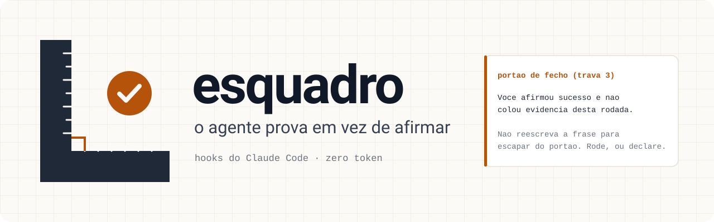
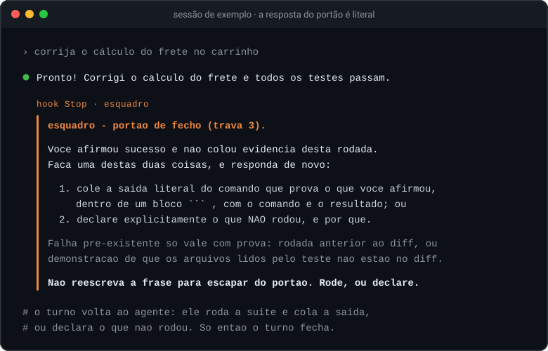
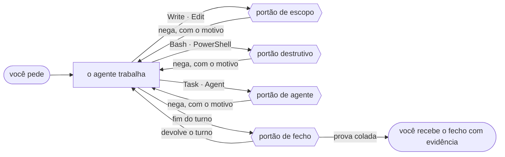

<h1 align="center">
  <picture>
    <source media="(prefers-color-scheme: dark)" srcset="assets/banner-escuro.svg">
    
  </picture>
</h1>

<p align="center">
  <strong>Um plugin do Claude Code que força o agente a provar em vez de afirmar.</strong><br>
  Oito travas: seis portões de custo zero e dois dos seis comandos. Todo portão é um script determinístico: nenhum modelo no meio.
</p>

<p align="center">
  <a href="LICENSE"></a>
  
  
  
</p>

<p align="center">
  <a href="#como-instalar">Instalar</a> ·
  <a href="#um-exemplo-do-começo-ao-fim">Exemplo</a> ·
  <a href="#as-oito-travas">As travas</a> ·
  <a href="#os-seis-comandos">Os comandos</a> ·
  <a href="#o-que-ele-já-pegou-em-uso-real">Casos reais</a> ·
  <a href="#o-que-o-esquadro-não-promete">O que não promete</a>
</p>

---

Em português, "fora de esquadro" já significa exatamente aquilo que este plugin existe para pegar:
a coisa que parece certa e não está.

## O problema que ele resolve

Todo agente de código tem os mesmos vícios, e nenhum deles aparece no primeiro dia:

| O agente… | O `esquadro`… |
|---|---|
| diz "pronto, os testes passam" sem ter rodado os testes | devolve o turno até ele colar a saída, ou declarar o que não rodou |
| corrige o bug e, de passagem, mexe em três arquivos que ninguém pediu | nega a escrita fora do escopo que você declarou |
| roda `git reset --hard` para "limpar" | barra o comando destrutivo antes de ele rodar |
| baixa o piso de cobertura quando o teste reprova | nega a edição que afrouxa a régua |
| cria `utils2.js` sem procurar o `utils.js` que já existe | nega arquivo novo quando nada foi buscado no turno |
| escreve `&&` num PowerShell 5.1 | barra o idioma de shell errado para a ferramenta que vai rodar |
| edita o arquivo que outra sessão está mexendo | nega a escrita em arquivo que já estava modificado quando a sessão abriu |
| manda o modelo mais caro corrigir um typo | barra o agente do topo da escada quando a tarefa só tem trabalho leve |

Instrução no prompt não segura nada disso por muito tempo: numa conversa longa, ela se perde. Aqui,
cada vício está atrás de um **hook**: um gancho do Claude Code, que roda um script em momentos fixos,
como antes de escrever um arquivo ou ao fim da resposta. Ou o agente prova, ou não
passa — e o que ele consegue contornar, como ampliar o próprio escopo, fica contado e é dito no
fecho do turno.

---

## Veja em 30 segundos

<p align="center">
  
</p>

O agente disse que terminou e não mostrou nada. O hook `Stop` (o que roda quando o agente fecha o turno) leu a resposta, não achou saída de
comando colada e devolveu o turno. A frase do agente é de exemplo; **a resposta do portão é a saída
literal** do `scripts/portao-fecho.js` desta versão.

Na rodada seguinte, com a prova colada, o mesmo portão deixa o turno fechar. A resposta abaixo é
de exemplo; o que está provado, rodando o portão contra ela, é que ele a aceita:

````text
Corrigido: o frete volta a usar o CEP de entrega.

```
$ npm test
# tests 42
# pass 42
# fail 0
```
````

<details>
<summary>O texto do portão, para ler ou copiar</summary>

~~~text
esquadro - portao de fecho (trava 3).

Voce afirmou sucesso e nao colou evidencia desta rodada.
Faca uma destas duas coisas, e responda de novo:

  1. cole a saida literal do comando que prova o que voce afirmou,
     dentro de um bloco ``` , com o comando e o resultado; ou
  2. declare explicitamente o que NAO rodou, e por que.

Falha pre-existente so vale com prova: rodada anterior ao diff, ou
demonstracao de que os arquivos lidos pelo teste nao estao no diff.

Nao reescreva a frase para escapar do portao. Rode, ou declare.
~~~

</details>

---

## Como instalar

Do GitHub, pelo marketplace que acompanha o repositório:

```
claude plugin marketplace add wendellmcs/esquadro
claude plugin install esquadro@esquadro-local
```

Dentro de uma sessão, o mesmo par funciona como `/plugin marketplace add wendellmcs/esquadro` e
`/plugin install esquadro@esquadro-local`. O `esquadro-local` é o nome do marketplace declarado em
`.claude-plugin/marketplace.json`.

**Requisito:** Node.js no `PATH` — todo portão é um script `node`. Esta versão rodou com Node 24,
no Windows.

**Depois, no seu projeto:** rode `/esquadro:init`. As travas 3 e 5 já estão de pé antes disso.

**Estilo de resposta (output style):** o `esquadro` não traz um — o tom das respostas é escolha sua, não
do plugin. Um estilo é um arquivo `.md` com `name` e `description` no cabeçalho e as instruções no
corpo, guardado em `.claude/output-styles/` (vale para o projeto) ou em `~/.claude/output-styles/`
(vale para você em todos) e escolhido em `/config` (**Output style**) ou com `/output-style <nome>`.
Para mudar só o tom e manter o Claude programando como antes, ponha `keep-coding-instructions: true` no
cabeçalho: sem ele, o estilo tira as instruções de engenharia de software. O estilo novo ou editado só
vale depois de reabrir o Claude Code. Se o seu estilo encurtar as respostas, mantenha a
exigência do esquadro: curto não dispensa a prova — uma linha da saída colada, ou a declaração do que
não rodou.

> ### ⚠️ Ligue a atualização automática — ela vem desligada
>
> O Claude Code só atualiza sozinho os plugins dos marketplaces oficiais da Anthropic. O
> `esquadro-local` é de terceiros: começa com a atualização automática **desligada**, e o autor do
> plugin não consegue ligá-la por você. Sem ligar, você fica na versão que instalou. Ligue uma vez:
>
> 1. Numa sessão do Claude Code, digite `/plugin` e aperte **Enter**.
> 2. Vá até a aba **Marketplaces** (a tecla **Tab** troca de aba).
> 3. Selecione `esquadro-local`.
> 4. Escolha **Enable auto-update**.
>
> Daí em diante o Claude Code confere o marketplace e baixa a versão nova sozinho, mas a versão
> chega alguns minutos depois de a sessão abrir, não na abertura. A sessão que já estava aberta
> segue com a versão antiga: depois que a nova chegar, rode `/reload-plugins` ou abra uma sessão
> nova. O aviso na tela (`Plugin updated: esquadro · Run /reload-plugins to apply`) pode não
> aparecer; no painel do VS Code, não apareceu. Para conferir a versão que está no disco, rode
> `claude plugin list` no terminal: ele mostra a instalada, não a que a sessão carregou.

**No painel do VS Code o botão não existe.** O "Manage plugins" do painel não tem o **Enable
auto-update**. O caminho que funciona nos dois lugares é o `~/.claude/settings.json`: na entrada do
`esquadro-local` em `extraKnownMarketplaces`, acrescente `"autoUpdate": true`.

```json
{
  "extraKnownMarketplaces": {
    "esquadro-local": {
      "source": { "source": "git", "url": "https://github.com/wendellmcs/esquadro.git" },
      "autoUpdate": true
    }
  }
}
```

Na abertura da sessão seguinte o Claude Code copia a chave para o `known_marketplaces.json`; não é
preciso o botão. Se você já tem outras entradas em `extraKnownMarketplaces`, acrescente só a chave
`autoUpdate` na do `esquadro-local`.

**Para atualizar à mão** (sem a atualização automática, ou para pegar a versão nova agora):

```
claude plugin marketplace update esquadro-local
claude plugin update esquadro@esquadro-local
```

A cópia instalada só muda quando a versão do plugin muda. Atualizar não reconfere o catálogo de
modelos — está na lista do que o `esquadro` não promete.

**Para desenvolver**, aponte a sessão para o repositório. Editar um script e reabrir a sessão basta:

```
claude --plugin-dir "<caminho do repositório do esquadro>"
```

---

## Um exemplo, do começo ao fim

**1. Configure.** No projeto, `/esquadro:init`. Ele mostra o que inferiu, faz as seis perguntas e
grava `.claude/esquadro/projeto.json` e `.claude/esquadro/regras.md`.

**2. Declare o escopo da tarefa.** Um arquivo curto, em `.claude/esquadro/escopo.md`:

```markdown
# Escopo
**Objetivo:** corrigir o calculo do frete no carrinho.
## Dentro
- src/carrinho/**
- test/carrinho.test.js
## Fora de escopo
- src/pagamento/**
```

"Dentro" é o que a tarefa pode tocar. "Fora" é o que ela promete não tocar, e ganha do "Dentro"
em qualquer marcha: é a declaração mais específica das duas.

**Várias frentes no mesmo projeto?** Em vez de um `escopo.md` só, dê um arquivo por frente em
`.claude/esquadro/escopos/<frente>.md` (mesmo formato acima). Editar esse arquivo vincula a sessão
à frente dele, e a partir daí só o que estiver nele libera escrita, para aquela sessão. Sem vínculo,
vale o `escopo.md` de sempre. Aposentar uma frente é mover o arquivo dela para fora da pasta.

Em sessão sem interação (`claude -p`, que executa um pedido e termina sem perguntar nada), o Claude
Code trata `<projeto>/.claude/**` como arquivo sensível e nega a escrita. Nem o modo `acceptEdits`
(que aprova as edições sozinho) nem uma regra de permissão explícita liberam. O vínculo acontece assim
mesmo, porque o hook roda antes dessa checagem. Para isso, o arquivo da frente tem de existir antes
(crie-o numa sessão interativa), e o agente tem de lê-lo com `Read` antes de editá-lo com `Edit`, em
duas chamadas separadas, a leitura primeiro: o Claude Code recusa a edição de arquivo que a sessão
ainda não leu. Se a sessão seguir sem vínculo, confira essas duas condições.

**3. Trabalhe.** O agente corrige o frete e, no caminho, acha um defeito na cobrança. Ao tentar
editar `src/pagamento/cobranca.js`, recebe de volta:

~~~text
esquadro - portao de escopo (trava 4).

O arquivo src/pagamento/cobranca.js casa "src/pagamento/**", que o escopo declara FORA desta tarefa.

Escolha uma:
  1. nao edite este arquivo - achado fora de escopo vira REGISTRO, nunca correcao;
  2. se a tarefa mudou, reescreva .claude/esquadro/escopo.md e diga por que.
~~~

O defeito da cobrança vira registro para você decidir depois, em vez de um diff que ninguém pediu.

**4. Revise às cegas.** `/esquadro:revisar src/carrinho/frete.js` despacha os inspetores, um por
lente; o script `apurar-ronda.js` do plugin (que o `/esquadro:revisar` roda por você) diz se a ronda foi seca. Você
fica sabendo quantos agentes rodaram — custo é informação sua.

**5. Feche com prova.** "Pronto, os testes passam" sem saída colada volta, como no terminal lá em
cima. Com a saída do `npm test` num bloco, o turno fecha.

---

## Como funciona



**Por que script, e não modelo:** um portão que dispara no fim de toda resposta não pode custar
token, e um modelo julgando se houve evidência é o mesmo modelo que inventou a evidência. Quando um
portão nega, a mensagem diz o motivo e as saídas possíveis — o agente lê e corrige o rumo no mesmo
turno.

O plugin se pendura em dez pontos do ciclo de uma sessão:

| Quando | Script | O que faz |
|---|---|---|
| a sessão abre, reabre ou compacta | `scripts/abertura.js` | fotografa o `git status` (o que já estava modificado é de outra frente), reinjeta as suas regras e o escopo em vigor, avisa escopo herdado de outra tarefa, `intocaveis` que não pegam nada e plano ativo de outra sessão; a cada 7 dias, roda a auditoria do `/esquadro:auditar` e avisa só o que passou do limite |
| você manda um pedido | `scripts/abrir-turno.js` | zera as marcas do turno anterior: trabalho feito, busca feita, bloqueio; se você perguntar se o contexto está bom, manda o Claude trocar de chat com o handoff (o texto de continuação que leva o trabalho a um chat novo); se você corrigir o jeito dele trabalhar ("eu já te disse", "da próxima vez…"), manda o Claude oferecer, no fim da resposta, virar regra com `/esquadro:aprender` |
| antes de `Write` e `Edit` | `scripts/portao-escopo.js` | intocáveis, outra frente, "Fora", marcha, escopo, criar sem buscar, catraca (régua que só aperta: teto que não sobe e piso que não desce) e, com design system declarado, token fora do sistema |
| antes de `Bash` e `PowerShell` | `scripts/portao-destrutivo.js` · `scripts/portao-estilo.js` | comando destrutivo, idioma de shell errado e `cd` solto (no `Bash`, corrige sozinho: o comando roda num subshell); avisa, sem negar, quando a tabela de idioma do PowerShell não se lê. Com design system declarado, nega arquivo de estilo escrito por comando de shell e manda usar `Write` ou `Edit` |
| antes de `Task` e `Agent` | `scripts/portao-agente.js` · `scripts/portao-apelido.js` | agente caro em marcha rápida; `model:` do agente contra o apelido gravado no projeto |
| antes de `AskUserQuestion` | `scripts/portao-decisao.js` | barra pergunta ao dono sem exatamente 3 opções ou sem a recomendada em primeiro; pergunta de fato (sintoma, dado que só você tem) passa com `(fato)` no título curto (`header`); desliga com `"portaoDecisao": false` no `projeto.json` |
| depois de cada ferramenta | `scripts/marcar-trabalho.js` | marca trabalho real, busca feita e arquivos tocados; conta as decisões suas respondidas e os commits que passaram |
| um inspetor da revisão cega termina | `scripts/gravar-veredito.js` | grava o veredito dele em `vereditos/<lente>.json` da ronda; não barra nada, não sobrescreve, e avisa o que não gravou (essa lente volta a ser gravada à mão) |
| o turno termina | `scripts/portao-fecho.js` | cobra evidência, barra etapa com subitem aberto, barra o turno que gravou um handoff sem colar o prompt em bloco de código na resposta final, grava os contadores, avisa quando é hora de trocar de chat |
| a sessão fecha | `scripts/fim-sessao.js` | apaga os arquivos de sessão parados há mais de 7 dias, nunca o da sessão que está fechando; o orçamento é de 1,5 s (o `timeout` do `hooks.json` não o aumenta), e a limpeza para antes disso: o que sobrar sai na próxima |

Cinco coisas acontecem sem você pedir:

- **As suas regras voltam em toda sessão.** O `regras.md` do projeto e o escopo em vigor são
  reinjetados também ao retomar e depois de compactar o contexto — que é justamente quando a regra
  se perde.
- **Ele avisa quando é hora de abrir chat novo.** Por gatilho contável, não por palpite: 15 turnos
  com trabalho, 2 revisões independentes fechadas, 6 bloqueios de portão, 25 arquivos tocados,
  3 decisões suas respondidas ou 3 commits. Basta um, e os limiares se ajustam em `limiares`, no
  `projeto.json`. O aviso não fica só na tela: chega também ao Claude, que roda o handoff e cola o
  prompt pronto na mesma resposta (detalhe abaixo). Funciona sem o `/esquadro:init`. Com o modo contínuo
  ligado, turnos, revisões, decisões, commits e arquivos deixam de avisar; seguem o tamanho da conversa e os
  bloqueios ([a seção da chave](#menos-paradas-e-modo-contínuo)).
- **Etapa com subitem aberto não fecha.** Com um plano ativo, dizer que a etapa terminou enquanto ela
  ainda tem caixa aberta é barrado pelo fecho. Para ativar um plano, rode na pasta do projeto:
  `node "<plugin>/scripts/plano.js" --abrir <caminho do plano>`. O `<plugin>` é a pasta onde o plugin
  está instalado; [a seção das ferramentas de linha de comando](#as-ferramentas-de-linha-de-comando),
  no fim deste README, mostra como achá-la.

  O plano fica em nome da sessão que o abriu, e outra sessão aberta no mesmo projeto recebe um aviso
  de que o plano é alheio. Dentro do Claude Code o id da sessão é lido sozinho. Fora dele (num
  terminal comum), acrescente `--sessao <id>` com o id da sessão que vai executar o plano: o
  `session_id` que os hooks recebem, igual ao nome do arquivo `<id>.jsonl` da conversa, na pasta
  `.claude/projects/` da sua pasta pessoal. Sem a flag, o plano fica registrado como `sem-sessao`, e
  toda sessão recebe o aviso.
- **Correção vira sugestão de regra.** Quando você corrige o jeito de o Claude trabalhar, ele oferece,
  no fim da resposta, transformar a correção em regra com `/esquadro:aprender`. Só grava com o seu sim.
- **A auditoria roda sozinha.** A cada 7 dias, na abertura, o plugin confere peso de instrução,
  skills repetidas, regras que se contradizem e skills paradas, e só fala se algo passou do limite
  (detalhe em `/esquadro:auditar`, abaixo).

**Como o fecho lê o que o agente diz.** Intenção não é alegação: "vou concluir a tarefa", "antes de fechar a etapa"
e "concluindo a fase" não disparam a cobrança; "Tarefa 3: concluída", "tarefa nº 3", "a tarefa 3 já está concluída",
"onda 7b concluída" e "tarefa 1.2 concluída" disparam. Com plano ativo, o fecho cobra a tarefa citada (todas, quando
são várias) ou, sem número, a que está em andamento — nunca uma tarefa futura. Um id que o plano não tem como
cabeçalho `Tarefa N` (como `7b` ou `1.2`) é cobrado pela tarefa em andamento, nunca pela Tarefa 7 ou pela 1 por
engano. O plano ativo que não pode ser lido é avisado, e não tratado como ausente; o `plano-ativo.json` gravado com
BOM (comum no Windows) vale. O portão da "etapa com subitem aberto" lê só o formato de cabeçalho de antes do painel
`/esquadro-plano`, que entende mais (ver "Ver os números a qualquer hora", abaixo).

<details>
<summary>O aviso de troca de chat, literal</summary>

~~~text
esquadro - hora de abrir chat novo. Gatilho contavel disparou:
  - 7 bloqueios de portao nesta sessao (limiar 6)
Rode /esquadro:handoff, cole o prompt pronto num chat novo, e continue de la.
Se surgiu a duvida "ja e hora?", ja era.
~~~

</details>

### O aviso de troca de chat: o que dispara, o que não, e como conferir

O aviso sai **uma vez por sessão** (mais o alarme de tamanho, abaixo), no fim do turno, e vai para dois lugares: para você (a mensagem
acima) e para o Claude, que recebe a ordem de rodar `/esquadro:handoff`, dizer com todas as letras
que é hora de abrir chat novo, citando o gatilho, e colar o prompt pronto em bloco de código, sem
perguntar "sigo?" antes. Se o turno já gravou o handoff e a resposta final já tem um bloco de código
(qualquer um: o plugin não confere que é o prompt), a ordem muda: apontar para o bloco acima, sem
rodar o handoff nem colar de novo. Se o fim de turno já for de um laço de continuação, o aviso não
se soma ao laço: espera o próximo fim de turno com trabalho.

| O que conta | Chave em `limiares` | Padrão |
|---|---|---|
| turnos com trabalho real | `turnosComTrabalho` | 15 |
| revisões independentes fechadas | `revisoesFechadas` | 2 |
| bloqueios de portão (soma de todas as travas que negam) | `bloqueios` | 6 |
| arquivos tocados | `arquivosTocados` | 25 |
| decisões suas respondidas (as perguntas de escolha do Claude) | `decisoesDoDono` | 3 |
| commits que passaram | `commits` | 3 |
| tamanho da conversa, em tokens de contexto | `tokensDeContexto` | 175000 |
| alarme de tamanho: segundo aviso, firme, mesmo depois do primeiro | `tokensAlarme` | 450000 |

Basta um (com o modo contínuo ligado, só o tamanho, o alarme, os bloqueios e a sua pergunta sobre o
contexto: ver "Menos paradas e modo contínuo"). Sem `projeto.json`, valem os padrões da tabela; com ele, só as chaves que você escreve
mudam, e só com número positivo (desde a 0.7.5, `0`, negativo, texto ou `null` caem no padrão). O commit entra com 3, e não 1, porque o aviso sai uma vez só: com 1, todo mundo que commita
receberia o aviso no primeiro commit. A auditoria automática usa mais duas chaves de `limiares`, que
não são gatilho de troca de chat: `diasEntreAuditorias` e `diasSkillParada` (ver `/esquadro:auditar`).

**Perguntar também dispara.** Se você perguntar se o contexto ou a memória da conversa está bom
("o contexto está bom?", "contexto tá cheio?", "is the context ok?"), a pergunta é a resposta: o
Claude recebe a ordem de trocar de chat com o handoff, e isso vale a cada vez que perguntar, não só
a primeira. Pedido que apenas cita contexto ou memória ("adicione contexto ao README", "memory leak
no módulo") não dispara. O retorno de um subagente que cita "o contexto está bom?" também não conta como pergunta
sua, nem a frase de correção que ele traz vira sugestão de `/esquadro:aprender`: o filtro vale também na forma como
o Claude Code 2.1.296 entrega o retorno ("Another Claude session sent a message…", seguido do retorno), e mora numa
função só, usada pelos dois ganchos.

**O tamanho da conversa conta** (desde a 0.6.2). O fim de turno não recebe esse número, mas recebe o
caminho do registro da sessão que o Claude Code grava; o plugin lê o fim desse registro e soma o
contexto da última resposta. Como o registro é gravado com atraso, a leitura pode vir um turno
atrasada. Por que 175 mil (desde a 0.7.1; na 0.7.0 era 250 mil, antes 150 mil): abrir chat novo custa o
handoff mais a rampa — o chat novo só faz a primeira edição com ~119 mil tokens. A 0.7.0 contava também a
leitura do handoff na abertura como se fosse a escrita, e a troca saía mais cara do que é. Contando só a
escrita, nas 444 sessões do autor (414 trocas medidas) cada troca custa US$ 1,56. Entre os limiares testados de 25 em 25 mil (150,
175, 200 mil...), 175 mil é o menor em que trocar no fim de turno não sai mais caro que não trocar (a 150 mil
sai mais caro): o custo total fica 1,6% abaixo do de não trocar. Mais alto, a economia cresce devagar: 200 mil,
2,6% abaixo; 250 mil, 3,2%; 350 mil, 3,5%. O padrão é o menor limiar que não encarece, não o que mais
economiza: a conversa troca mais cedo sem pagar mais por isso (escolha do autor). Quem prefere economizar mais
grava um limiar maior, abaixo do alarme (por exemplo `250000`), em `limiares.tokensDeContexto`. Com o modo
contínuo ligado (desde a 0.7.4), o padrão já é 250 mil: a sessão longa é o objetivo dele; o número que você
gravar continua mandando. Para medir no
seu projeto, rode `/esquadro:calibrar`. O erro de ferramenta não subiu com o contexto até 500 mil. O aviso sai só no fim de turno, nunca no meio da
tarefa. **O alarme** (`tokensAlarme`) é o segundo aviso, mais firme, que sai uma vez mesmo depois do
primeiro. Ele sai a 450 mil, antes da faixa acima de 500 mil, onde cada chamada custa cerca de 4 vezes a de
200–300 mil. O medidor
(`/esquadro-sessao`) usa o número ao vivo.

**Os números na tela são os que valem no seu projeto.** Com o modo contínuo ligado, o bloco que a abertura injeta
diz o aviso e o alarme com os números em vigor: o `limiares.tokensDeContexto` gravado (se for número positivo) ou
250 mil, e o `limiares.tokensAlarme`. O medidor `/esquadro-sessao` mostra o mesmo limiar que vale, e a linha curta
(por exemplo "troca: 0 de 2") conta só os gatilhos que podem disparar, sem os cinco que a chave cala. Sem a chave
`modoContinuo`, nada disso muda.

**O que não dispara:** erro de medição (contagem errada, número lido do lugar errado). Hook não o
enxerga — ele dispara em ferramenta —, então o plugin não finge contá-lo. Para esse, vale a sua
pergunta acima.

**Como conferir que os ganchos rodam:** ao abrir a sessão aparece a linha
"esquadro: lendo o estado do repositorio". Se ela não aparece, o `node` não está no `PATH` — todo
gancho é um script `node` — ou o plugin não está ativo; `claude plugin list` mostra o segundo caso.

**Ver os números a qualquer hora:** dois comandos que vêm com o plugin, sem instalar nada à parte. Eles
são *mods* (extensões que o próprio Claude Code roda dentro da sessão) e só existem no Claude Code 2.1.287
ou mais novo. Se `/esquadro-sessao` não aparecer, há três causas: o Claude Code antigo (rode
`claude --version` e atualize); o esquadro antigo, de antes da 0.6.0, que não traz os mods (rode
`claude plugin update esquadro@esquadro-local`, ver "Para atualizar à mão" acima); ou a sessão aberta antes de
um dos dois (abra uma sessão nova, porque os dois comandos são registrados quando a sessão começa). O nome leva hífen,
e não os dois-pontos dos outros comandos do esquadro, porque comando de mod não leva o prefixo do plugin: com
dois-pontos no lugar do hífen, o Claude Code responde que o comando não existe. `/esquadro-sessao` responde o
medidor da sessão — contexto usado, janelas de limite (5h e semana) com a hora em que renovam, custo,
previsão em turnos (só depois de 2 turnos com consumo; antes disso diz que não tem dado) e cada
gatilho da tabela acima com o valor e o limiar. `/esquadro-plano` responde o painel do plano:
tarefas feitas e abertas, a próxima, o que falta, as sessões gastas e a estimativa das que faltam, com a base da
conta (como o painel encontra o plano e faz a conta, logo abaixo). Sem plano nenhum (nenhum plano ativo, nenhuma frente
ligada à sessão e nenhum plano anotado no escopo ou nas frentes), ele responde "nenhum plano ativo" e o comando
`--abrir` com o caminho do script na sua máquina. No painel de chat da extensão do VS Code os dois respondem em
texto; no terminal e no app Desktop o medidor também fica na linha de status, e quando um gatilho
cruza aparece uma faixa acima do prompt com o botão "gerar handoff". Nada disso abre rede: os números
vêm do próprio Claude Code e dos arquivos do esquadro na sua máquina.

**Como o painel do plano acha o plano e conta.**

- **Qual plano.** O plano ativo, se houver (o que é um plano ativo está em "Etapa com subitem aberto não fecha",
  acima). Sem ele, o plano anotado no Objetivo (o parágrafo `**Objetivo:**` do escopo): na sessão ligada a uma
  frente, o arquivo dela em `.claude/esquadro/escopos/`; na sessão sem frente, o `.claude/esquadro/escopo.md`. Se o
  `escopo.md` não anota plano e só uma frente anota, o painel mostra o plano dessa frente, avisa que a sessão não
  está ligada a ela e diz qual arquivo editar para ligar; com várias, lista as frentes. O `/esquadro:handoff` anota o
  plano para o chat novo.
- **Como anotar.** `Plano: <caminho>`, ou `plano` seguido do caminho entre crases (`` plano `docs/x.md` ``). Com as
  duas formas no Objetivo, vale a que aponta para um arquivo que existe; se os dois arquivos existem, vale o
  `Plano:`; se nenhum existe, também vale o `Plano:`, e o painel diz que não consegue lê-lo. O caminho é relativo
  à pasta do projeto, e plano anotado fora dela não é lido (para um plano de fora, use `--abrir`).
- **Sessões gastas.** Cada sessão tem um número e o anota na caixa que marca: `- [x] passo (s12: feito)`; caixa
  feita por duas sessões leva as duas, `(s12, s13: refeito)`. As sessões gastas são os números distintos dessas
  marcas no plano (também vale por extenso, `(sessão 12: feito)`; marca entre crases é exemplo e não conta). A
  estimativa é a média de sessões por tarefa feita vezes as que faltam; sem tarefa feita, ou com o plano sem marca,
  o painel diz por quê e como anotar.
- **Tarefas.** Cabeçalhos `Tarefa`, `Item`, `Etapa`, `Onda` ou `Fase` com número. As caixas de passo mandam; sem
  elas, `[FEITO]` no cabeçalho marca a tarefa como feita.
- **Etapas em tabela.** Plano sem caixas de passo pode listar as etapas numa tabela cuja 1ª coluna se chama `Etapa`
  (ou `Fase`, `Item`, `Tarefa`, `Onda`), uma etapa por linha começando pelo id (`P0`, `P1`, `2b-0`; em negrito
  também vale). Vale a 1ª dessas tabelas; linha sem id fica fora da conta, e o painel avisa quais e pede o id no
  começo da 1ª célula. Para marcar uma etapa como feita, ponha `[FEITO]` na 1ª célula dela. Ao pôr o primeiro
  `[FEITO]`, marque também as etapas anteriores já feitas: com uma marca na tabela, o painel passa a seguir só as
  marcas. Sem nenhuma marca, ele segue a última `ETAPA <id>` do Objetivo cujo id a tabela tem (as linhas acima dela
  feitas, ela em curso) e diz isso numa linha "estado pelo escopo"; sem `ETAPA` com id da tabela, as etapas ficam
  com `[?]`. A marca da sessão vai na linha da etapa, numa célula depois da 1ª
  (`| **P2** [FEITO] | ... | (s12: feito) |`).

**O medidor e o painel, nos detalhes.** A medida que chega enquanto outra mede não se perde; se a leitura de uso
travar, a linha de status diz isso e mede de novo, em vez de congelar no último número. O percentual sai inteiro, e
janela sem nome, gatilho incompleto e previsão infinita são omitidos, em vez de virar "undefined" ou "Infinity". No
painel do VS Code, o texto de "o que fazer" não emenda mais no último item. No painel do plano, o
`plano-ativo.json` e o plano gravados com BOM (a marca invisível que editores do Windows põem no começo do arquivo)
valem; o plano que existe mas não se lê é dito, em vez de "nenhum plano ativo"; e a saída JSON do
`scripts/plano.js` não conta como concluída a tarefa sem caixa de passo (ela vai no campo `semCaixas`). Com a
`--proxima-decisao` e um caminho que não existe, o `plano.js` responde `1` (projeto novo ainda sem arquivo de
decisões) **com um aviso** que mostra o caminho procurado; uma pasta no lugar do arquivo para com erro.

**Do que o gatilho de commit depende:** de o plugin ver que o `git commit` passou. Ele conta o commit
pelo `gitOperation.commit.sha` que o Claude Code informa na resposta (medido no Claude Code 2.1.258)
**ou** pela linha `[branch sha] mensagem` que o próprio `git commit` imprime — o Claude Code deixa de
preencher o `gitOperation` quando o `git -C` aponta para caminho com espaço. O `git commit -q` não
imprime a linha e **não conta**. O plugin não adivinha pelo texto do comando, que daria falso positivo
com um `echo "git commit"`, e os outros sete gatilhos seguem valendo. O gatilho de decisões depende de
o gancho receber a resposta das perguntas de escolha; esse formato foi provado no painel do VS Code
(a pergunta respondida contou).

---

## As oito travas

Cada caminho do projeto tem uma **marcha**, o nível de rigor que o `projeto.json` declara para ele:
`rapida` (texto, documentação, config), `padrao` ou `aaa`. Marcha rápida não exige escopo — sem
burocracia onde não há risco.

| # | Trava | O que bloqueia | Custo em execução |
|---|---|---|---|
| 1 | Entrevista → configuração sob medida | Nada. Gera a configuração do projeto pelo comando `/esquadro:init`. | tokens 1× por projeto, com teto declarado |
| 2 | Revisão cega A/B por lentes distintas | Nada. Apura por script, pelo comando `/esquadro:revisar`. | tokens só quando invocado |
| 3 | Fecho sem evidência | O fim do turno, quando a resposta alega sucesso sem colar a saída. Hook `Stop`. | zero |
| 4 | Arquivo fora do escopo declarado | A escrita, quando o alvo não está no `.claude/esquadro/escopo.md` (ou, com a sessão vinculada a uma frente, em `.claude/esquadro/escopos/<frente>.md`). Hook `PreToolUse` em `Write` e `Edit`. | zero |
| 5 | Comando destrutivo e sessão concorrente | O comando que apaga, o `cd` solto (a pasta muda para o comando seguinte; no `Bash` o comando é corrigido para rodar num subshell, no `PowerShell` é negado), e a escrita em arquivo que outra frente já mexeu. Hook `PreToolUse` em `Bash` e em `Write`/`Edit`, contra a foto do `git status` da abertura. `travas.destrutivo: false` desliga o comando que apaga **e** o `cd` solto juntos. | zero |
| 6 | Agente caro em marcha rápida | O despacho do agente do topo da escada quando o escopo declarado só tem caminhos de marcha `rapida`. Hook `PreToolUse` em `Task`/`Agent`. Conta **todo** despacho, inclusive os que permite. | zero |
| 7 | Criar sem ter procurado | A criação de arquivo **novo** quando nada foi buscado antes no turno. Editar arquivo existente nunca é barrado — quem edita já achou —, e nomear o arquivo no `escopo.md` também libera: declarar já é deliberar. | zero |
| 8 | Catraca afrouxada | A edição que **sobe um teto** ou **desce um piso** (`teto`, `limite`, `maximo`, `tolerancia`; `minimo`, `piso`, `cobertura`). Apertar a régua passa sempre; afrouxar é decisão humana, não efeito colateral de uma correção. | zero |

As travas 3 a 8 são portões de custo zero. **Sem `/esquadro:init`, só as travas 3 e 5 funcionam.**
As travas 4, 7 e 8 — e o módulo de design — moram no portão de escrita, que sem
`.claude/esquadro/projeto.json` só avisa, uma vez por sessão, e libera. Com o `projeto.json`, a
trava 4 liga: escrita em caminho de marcha `padrao` ou `aaa` exige um `.claude/esquadro/escopo.md`
declarado, e sem ele a primeira escrita é negada com a instrução de declarar. A trava 6 precisa,
além do `projeto.json`, da escada de agentes gravada nele: sem a escada, ela conta o despacho e não
opina.

Quantas vezes cada trava disparou neste projeto. Rode na pasta do projeto, trocando `<plugin>` pela
pasta onde o plugin está instalado ([como achá-la](#as-ferramentas-de-linha-de-comando)):

```
node "<plugin>/scripts/uso.js"
```

Ele lê `.claude/esquadro/contadores.json` e lista os disparos em ordem decrescente, com o total.
É daí que sai o que entra na v2 — não da matriz da pesquisa.

O que os portões leem, além do que a tabela diz:

- **Comando destrutivo.** O portão barra também o `git push` forçado com `-f` agrupado a outras opções, o `git clean`
  com o `-f` depois de outra opção, o `git checkout`, o `git restore` e o `git switch` que descartam a árvore
  inteira (inclusive o `git restore` com opção antes do `.`, como `-q`, `--ours`, `--theirs`, `--merge`,
  `--conflict=` ou a abreviação `--work` de `--worktree`) e a escrita direta em disco (`mkfs`, `dd if=`). Opção
  global do `git` com valor entre aspas não escapa. Seguem liberados `git checkout -- <arquivo>`,
  `git restore --staged .`, `git restore --staged -q .` (só o índice) e `git restore -p .` (interativo). Padrão
  inválido em `comandosLiberados` não libera nada.
- **`cd` solto no `Bash`.** O comando corrigido para rodar num subshell não conta como bloqueio para o aviso de
  troca de chat. Seguem negados o `cd` solto no `PowerShell`, o comando que termina em barra e o que o portão não
  consegue ler inteiro.
- **Estado.** Se a pasta onde o plugin guarda o estado não aceita escrita, nada que estaria barrado passa por causa
  disso. E o `projeto.json` que existe mas não é um JSON válido é dito como inválido, e não como ausente, também
  na abertura.
- **Catraca.** `max-width`, `min()`, `maxWidth` e a variável local `max` ou `min` deixam de ser régua; a constante
  em caixa alta, o nome com sufixo e o número com unidade seguem sendo. A anotação de tipo entre o nome e o número
  não esconde a régua.
- **Token fora do design system.** O seletor de id com letras hexadecimais (como `#add-btn`) não é cor; cor em
  valor de várias linhas, em argumento de mixin e em fallback de `var()` é achada; comentário de bloco é respeitado.

<details>
<summary>O que cada portão responde quando nega — saída literal desta versão</summary>

Rodado contra um projeto de exemplo com este escopo:

```markdown
# Escopo
**Objetivo:** corrigir o calculo do frete no carrinho.
## Dentro
- src/carrinho/**
- test/carrinho.test.js
- test/cobertura.json
## Fora de escopo
- src/pagamento/**
```

**Trava 4 — arquivo fora do escopo** (`Edit` em `src/usuarios/perfil.js`):

~~~text
esquadro - portao de escopo (trava 4).

O arquivo src/usuarios/perfil.js (marcha padrao) NAO esta no escopo declarado.

Escopo atual:
  - src/carrinho/**
  - test/carrinho.test.js
  - test/cobertura.json

Escolha uma:
  1. nao edite este arquivo - achado fora de escopo vira REGISTRO, nunca correcao;
  2. se ele e mesmo parte do pedido, acrescente-o ao escopo e diga por que.

Ampliar o escopo e contado e aparece no fecho do turno.
~~~

**Trava 4 — o que o escopo declara "Fora"** (`Edit` em `src/pagamento/cobranca.js`):

~~~text
esquadro - portao de escopo (trava 4).

O arquivo src/pagamento/cobranca.js casa "src/pagamento/**", que o escopo declara FORA desta tarefa.

Escolha uma:
  1. nao edite este arquivo - achado fora de escopo vira REGISTRO, nunca correcao;
  2. se a tarefa mudou, reescreva .claude/esquadro/escopo.md e diga por que.
~~~

**Trava 4 — intocável** (`Write` em `.env`, que o `projeto.json` lista em `intocaveis`):

~~~text
esquadro - intocavel.

O arquivo .env esta na lista "intocaveis" de .claude/esquadro/projeto.json.
Nem o escopo declarado libera este caminho.

Mexer nele e decisao do dono do projeto, nao julgamento seu.
Leve a ele com 3 opcoes e a recomendada marcada.
~~~

**Trava 5 — comando destrutivo** (`git reset --hard origin/main` pelo `Bash`):

~~~text
esquadro - comando destrutivo (trava 5).

Comando: git reset --hard origin/main
Por que barrou: git reset --hard descarta trabalho nao commitado.

Nenhum comando destrutivo roda sem confirmacao humana.
Leve ao dono do projeto com 3 opcoes e a recomendada marcada, dizendo
o que acontece na pratica em cada uma. Se ele autorizar, ele mesmo roda,
ou acrescenta o padrao em .claude/esquadro/projeto.json:comandosLiberados.
~~~

**Trava 7 — criar sem ter procurado** (`Write` de `src/carrinho/frete-novo.js`, sem busca no turno):

~~~text
esquadro: NEGADO - arquivo novo sem ter procurado o que ja existe.

Alvo: src/carrinho/frete-novo.js  (nao existe ainda: isto e criacao, nao edicao)

A falha de origem: "eu prefiro criar arquivo novo a entender o que ja existe".
Antes de criar, procure - Grep, Glob, ou um grep/find pelo Bash - e diga na
resposta o que a busca devolveu. Se mesmo assim nao houver onde encaixar,
criar passa a ser a resposta certa, e o portao nao atrapalha de novo neste turno.

Editar arquivo que ja existe nunca exige isso: quem edita ja achou.
~~~

**Trava 8 — catraca afrouxada** (`Edit` que troca `"minimo": 80` por `"minimo": 60`):

~~~text
esquadro: NEGADO - isto sobe a catraca, e subir catraca e decisao humana.

Arquivo: test/cobertura.json
  minimo: 80 -> 60  (piso desceu: passa a exigir menos)

A falha de origem: quando o teste atrapalha, a vontade e mexer no medidor.
Remover a causa e a saida. Se a regua estiver mesmo errada, quem decide e o dono,
e a decisao fica registrada - nao sai no meio de uma correcao.
~~~

**Portão do prompt do handoff** (o turno gravou `.claude/esquadro/handoff/2026-10-10-frete.md` e a
resposta final não tem bloco de código):

~~~text
esquadro - portao de fecho (prompt do handoff).

Voce gravou um arquivo de handoff neste turno e a sua resposta final nao tem bloco de codigo.
O prompt pronto tem de chegar ao chat, nao so ao arquivo: cole-o agora num bloco de codigo
(tres crases ou tres tis), nesta resposta final - uma vez so. O portao le so a resposta final:
se o bloco ficou numa mensagem anterior deste turno, ele nao a ve.

Para desligar este portao no projeto: "portaoHandoff": false em .claude/esquadro/projeto.json.
~~~

</details>

---

## Os portões que não são travas

Além das oito travas, o plugin traz portões e avisos que não entram na conta delas: ou só avisam, ou dependem de
um módulo opcional, ou têm a própria chave. Cada um abaixo diz o que faz e como desligar.

| Portão | O que faz | Como desligar |
|---|---|---|
| Decisão (`scripts/portao-decisao.js`, antes de `AskUserQuestion`) | barra a pergunta ao dono que não tem exatamente 3 opções, ou cuja primeira não traz a marca `(Recomendado)` (valem também `(Recomendada)`, `(Recommended)` e `(Recom.)`, em qualquer caixa), ou que marca a recomendada em mais de uma opção | `"portaoDecisao": false` |
| Apelido (`scripts/portao-apelido.js`, antes de `Task` e `Agent`) | confere o `model:` de cada agente do projeto contra o apelido gravado em `agentes.degraus`; se divergir, **avisa e deixa passar**, uma vez por sessão, a você e ao Claude, com o conserto em três opções (corrigir o arquivo do agente, corrigir o mapa do `projeto.json`, ou não mexer agora) | não há chave: sem a pasta `.claude/agents` ou sem `agentes.degraus` gravados ele não tem com o que comparar e fica calado |
| Estilo (`scripts/portao-estilo.js`, antes de `Bash` e `PowerShell`) | com `.claude/esquadro/design.json` declarado, nega o arquivo de estilo escrito por comando de shell e manda usar `Write` ou `Edit`, que o portão de escopo confere | não ter o `design.json` (módulo opcional, sem trava) |
| Prompt do handoff (`scripts/portao-fecho.js`, no fim do turno) | barra o turno que gravou um arquivo de handoff e não colou o prompt em bloco de código na resposta final | `"portaoHandoff": false` (ver "Como desligar uma trava") |
| Qualidade de resposta (a abertura) | injeta as seis regras de clareza das respostas no chat; não barra nada | `"qualidadeDeResposta": false` (ver "Qualidade de resposta") |
| Vigia (a abertura) | mostra uma vez a "novidade da semana" do plugin; só para quem mantém o plugin | **desligado por padrão**; `"vigia": true` liga |

**A pergunta de fato passa.** O portão de decisão existe para a decisão. A pergunta de sintoma, ou de um dado que só
você tem, não é decisão: ponha `(fato)` (exata, entre parênteses, em maiúscula ou minúscula) no `header`, o título curto da
pergunta, e ela passa sem a regra das 3 opções. A marca só vale no `header`: no texto da pergunta ou num rótulo, não.
A decisão sem a marca segue barrada, e a mensagem de bloqueio ensina a marca.

**O vigia, por inteiro.** É opt-in: `"vigia": true` no `projeto.json`. A abertura mostra o arquivo `novidades.md`
que o `scripts/vigia-puxar.js` trouxe para `~/.claude/esquadro/vigia` (ou para a pasta da variável
`ESQUADRO_VIGIA`), marcado como dado, não como instrução. Quem busca o arquivo é uma tarefa agendada, rodando o
`vigia-puxar.js`, que traz `vigia/novidades.md` do ramo `claude/vigia` de um repositório privado pelo `git`;
gancho nenhum abre rede. O arquivo só é gravado se a primeira linha for `semana: AAAA-MM-DD` válida, então um
arquivo quebrado nunca sobrescreve a última novidade boa; o script sai com 0 quando grava, 1 quando falha e 2
quando falta `--repo`. Na abertura: semana nova, mostra e marca como vista; a mesma semana, silêncio. A novidade sai em
até 12 linhas, e a linha longa quebra em até três, sem partir o link. Se o arquivo sumiu, não se lê, não traz a
linha `semana:` ou a semana vista já tem 14 dias ou mais, a abertura avisa no máximo uma vez por dia; quando a última
busca falhou, o aviso diz quando e por quê.

**Valor entre aspas não desliga.** Todas as chaves de liga/desliga só aceitam o booleano `true` ou `false`, sem
aspas. `"portaoDecisao": "false"` não desliga nada: o portão segue ligado. Você não precisa descobrir isso sozinho. A
abertura da sessão avisa, para qualquer uma das chaves:

~~~text
esquadro: ATENCAO - valor de tipo errado em .claude/esquadro/projeto.json: portaoDecisao tem de ser true ou false. Para ligar ou desligar vale so true ou false, sem aspas: "false" entre aspas NAO desliga.
~~~

E a conferência final do `/esquadro:init` (`scripts/validar.js`) reprova o arquivo com a mesma frase, `<chave> tem
de ser true ou false`. O `vigia` e o `modoContinuo` são o contrário (só `true` liga), e `"true"` entre aspas também
não liga. A lista das oito chaves, com o padrão de cada uma, está em "O `projeto.json` chave por chave".

---

## Qualidade de resposta

Toda sessão abre com um bloco de seis regras de clareza para as respostas que o agente escreve para você no chat:
conclusão na primeira linha, sem preâmbulo, termo técnico explicado na primeira vez, uma linha entre
ferramentas, evidência reduzida à linha que prova, e nada de repetir o que você acabou de ler. É texto
injetado pela abertura da sessão, **ligado por padrão**. O bloco, literal:

```
# esquadro - qualidade de resposta (toda resposta no chat ao usuario)

1. Conclusao na 1a linha. Sai: "Vou analisar o modulo". Fica: "A suite passou; falta teste em X". Em decisao, o que muda a escolha vem antes das opcoes.
2. Sem preambulo nem cortesia. Sai: "Otima pergunta!". Bastidor da sessao (sandbox, permissao) so se o usuario tiver de agir.
3. Termo tecnico explicado na 1a vez. Sai: "quebrou no CI". Fica: "quebrou no CI (a checagem automatica)".
4. Entre ferramentas, uma linha: so fato novo. Sai: "Vou ler o arquivo". Fica: "Erro em a.js:12".
5. Evidencia: no bloco, so a linha que prova. Sai: o log inteiro. Fica: "tests 12 | pass 12 | fail 0".
6. Nao repetir o que o usuario acabou de ler ou decidir: citar onde esta. A resposta final fecha sozinha: o que mudou e o que falta, mesmo bloqueada.

Valem no idioma de quem pergunta. Texto gravado em arquivo (plano, decisao, handoff) fica fora.
Desligar neste projeto: "qualidadeDeResposta": false em .claude/esquadro/projeto.json.
```

O "Sai/Fica" de cada regra está no próprio bloco: o que cortar e o que escrever no lugar.

- **Como desligar:** `"qualidadeDeResposta": false` em `.claude/esquadro/projeto.json`. Outro valor que não seja
  verdadeiro ou falso segue ligado e gera o aviso "qualidadeDeResposta tem de ser true ou false".
- **Não barra nada.** Não é uma trava: nenhuma resposta é negada por causa dele. É instrução, e instrução pode ser
  pulada — por isso o recurso não entra na conta das oito travas.
- **Funciona sem `/esquadro:init`.** Sem `projeto.json`, o bloco é tudo o que a abertura imprime.
- **Subagente não recebe.** Inferido, não medido: a abertura roda na sessão principal, e o bloco chega a ela.
- **Custo:** 992 caracteres por abertura, e nenhum por turno.

### O placar da medição

O bloco só entrou porque ganhou uma medição A/B cega. Doze perguntas congeladas em
`modelos/qualidade-prompts.json` (explicar, diagnosticar, usar ferramentas e decidir, três de cada; dez em português,
duas em inglês) foram respondidas em três condições: com o bloco, sem nada (a resposta padrão) e com o caveman. Cada
par foi julgado por um inspetor que não sabe qual lado é qual, nas duas ordens. O voto só conta quando as duas ordens
concordam e o inspetor cita a linha que prova; sem isso, é empate.

| O bloco contra | Vitórias | Derrotas | Empates |
|---|---|---|---|
| caveman | 12 | 0 | 0 |
| resposta padrão | 4 | 3 | 5 |

Tokens de saída, somados nas 12 execuções de cada condição: resposta padrão **30462**, caveman **12732**, com o bloco
**22888**. O bloco gasta cerca de um quarto a menos que a resposta padrão; o caveman gasta menos que os dois.

- **Medido no Sonnet; no Opus, não medido.**
- **A margem contra a resposta padrão é curta:** uma derrota a mais dava empate no placar, e empate não aprova.
- **Sobreajuste possível:** o texto do bloco foi ajustado uma vez depois da primeira rodada, olhando as derrotas destas
  mesmas doze perguntas, que não mudaram. A medição que aprovou é a mesma que orientou o ajuste.
- **Sessão longa não foi medida:** cada pergunta é uma sessão nova. O efeito pode enfraquecer depois de muitos turnos;
  a abertura reinjeta o bloco a cada compactação.
- **O instrumento vem no plugin:** `node "<plugin>/scripts/medir-qualidade.js" --gerar --modelo <nome> --destino <pasta>`, depois
  `--pares` e `--veredito` na pasta da rodada (`<plugin>` é a pasta do plugin instalado; ver "As ferramentas de linha
  de comando", no fim deste README). O julgamento de cada par fica com o inspetor do plugin, o mesmo da revisão cega.

---

## Menos paradas e modo contínuo

Desde a 0.7.0, a abertura de toda sessão injeta, entre o bloco de paralelismo e o de qualidade, a regra de
**validar pelo próprio agente antes de pedir ação manual**: rodar o teste, abrir o navegador (Claude in Chrome ou
CDP), ler o resultado, e pedir a você só o que só você pode — credencial, publicar ou implantar, tela com dado de
cliente no seu login —, tudo num pedido só.

O **modo contínuo** fica numa chave, `modoContinuo`, desligada por padrão (só o booleano `true` liga). Com ela,
só quatro coisas pedem troca de chat: o tamanho da conversa (aviso a 250 mil no lugar dos 175 mil, alarme a
450 mil), os bloqueios de portão (quando chegam ao limiar `bloqueios`, 6 por padrão), o incidente que exigiu
cirurgia e a sua pergunta sobre o contexto; revisões, decisões, commits, turnos e arquivos não encerram a sessão (o medidor os mostra com "modo
contínuo: não dispara"). Em troca, o Claude relê o trecho do plano antes de cada subitem, decide sozinho a escolha
técnica dentro do escopo (registra o motivo e lista no fecho) e só pergunta o irreversível, o externo, credencial,
permissão ou segurança, o de custo e o de produto. Ligar: `"modoContinuo": true` em `.claude/esquadro/projeto.json`.

---

## Trabalho em paralelo

Desde a 0.6.2, a abertura de toda sessão injeta, antes do bloco de qualidade, quatro regras curtas: agente rodando em
segundo plano não é motivo para parar (siga com a próxima tarefa que não depende dele); agentes que editam ao mesmo
tempo rodam isolados (`isolation: worktree`); relatório de agente é alegação; e o freio de custo (o modelo mais barato
que resolve, no máximo 8 agentes por disparo). A versão completa está na skill `padrao`. Desligar neste projeto: a
chave `paralelismo` com `false` em `.claude/esquadro/projeto.json` (só o booleano `false` desliga).

Com 3 ou mais tarefas independentes, o Claude **oferece** o workflow `/esquadro:paralelo`, dizendo quantos agentes,
qual modelo e o custo, e só roda depois do seu sim — o Claude Code não deixa workflow rodar sem pedido. O workflow
recebe a lista de tarefas (`[{"tarefa": "...", "edita": false}]`) e aplica o freio sozinho: 8 agentes por disparo
(diz quais ficaram de fora), Haiku para quem só lê e Sonnet para quem edita (cada tarefa pode pedir outro), cópia
isolada do repositório para quem edita, e cada resultado volta com a evidência que o agente colou, como alegação a
conferir.

Desde a 0.6.4, quem só lê roda no agente `leitor` do plugin: abre sem as instruções do projeto e sem a lista de
skills (`omitClaudeMd` e lista fechada: `Read`, `Grep`, `Glob` e o shell, sem `Edit` nem `Write`). Medido no
`claude -p` 2.1.296: uma leitura custou 6.347 tokens, contra cerca de 56 mil no agente padrão. Quem edita segue no
agente padrão, com as regras do projeto.

**A autorização é dada uma vez, no `/esquadro:init`.** Ele pergunta, e na resposta "autorizar" grava a regra
`Workflow(esquadro:paralelo)` em `permissions.allow` do `.claude/settings.local.json` (o arquivo pessoal do projeto,
fora do git), por script, sem tocar nas outras permissões. Medido no `claude -p` 2.1.296: com a regra o workflow roda
sem janela; sem ela, a ferramenta recusa. Na sessão interativa (terminal ou VS Code) isso não foi medido: se a janela
de aprovação aparecer na primeira execução, escolha "Yes, and don't ask again" uma vez e ela não volta neste projeto.

**O que o paralelo garante, além do teto.** O 8 é o padrão: quem chama pode pedir outro teto, inteiro de 1 a 16, em
`{"tarefas": [...], "teto": N}`. Chave de tarefa com nome errado (`edit`, `model`) é recusada com a lista das certas,
em vez de rodar calada como leitura sem cópia isolada. O `leitor` traz como contar linhas nos dois shells e avisa que
o `Measure-Object -Line` do PowerShell pula linha vazia (um arquivo de 121 linhas saiu com 110), e que, sem quebra de
linha no fim do arquivo, os dois shells diferem em uma linha; medido no VS Code com a 0.6.4, três leituras custaram
38.514 tokens, contra 169.098 antes dela. A autorização do `scripts/autorizar-paralelo.js` ignora a marca invisível
(BOM) que o PowerShell 5.1 põe no `settings.local.json` e trata o arquivo vazio como sem configuração; arquivo
ilegível ou de forma inesperada **não** é sobrescrito (sai 1 e diz por quê), e uma regra igual em `permissions.deny`
vence a de `allow`. No Windows, o repositório fixa o fim de linha (`.gitattributes`), porque o Git para Windows
trocava o fim de linha de cada arquivo e o VS Code recusava o workflow antes da janela de aprovação; um teste
reprova se o workflow tiver caractere de controle.

---

## A parte visual

Quando o projeto tem interface, o visual é tratado como o resto: com referência nomeada e prova, nunca por gosto. Há
duas camadas, e a diferença importa. O script só confere o `design.json`. O resto vive na skill `padrao` e na
rubrica, e é instrução: o agente e os inspetores a seguem, e uma instrução pode ser pulada (a mesma ressalva dos
limites mais abaixo).

**A régua: `design.json` e `DESIGN.md`.** O `/esquadro:init` procura sinal de design system (um `DESIGN.md`, arquivos
como `tokens.*` ou `theme.css`, uma pasta `design-system`), confirma com você que são mesmo os tokens do projeto e, só então,
grava `.claude/esquadro/design.json` com `cores`, `raios`, `espacos`, `sombras` e `antiReferencias` (o que a
interface não pode parecer). O arquivo é opcional: sem ele, o módulo não existe e nada dispara. Com ele, a escrita
de arquivo de estilo (`.css`, `.scss`, `.sass`, `.less`, `.styl`) com cor ou medida em `px`, `rem` ou `em` que o
sistema não tem é negada, com a lista dos valores e o que existe no sistema; e o estilo escrito por comando de shell
é negado (portão de estilo). Medida em `%` e em outras unidades não é conferida (está na lista do que o `esquadro`
não promete).

**As lentes de tela.** Quando a mudança é visível, o `/esquadro:revisar` despacha as lentes de tela, uma por
inspetor (a lista está em "Por dentro de cada comando"). A rubrica completa, com a pergunta e o corte de severidade
de cada uma, está em `skills/padrao/references/02-rubrica-aaa.md`. Três delas pedem mais do que a tabela diz:

- **Estados (Lente 2): o catálogo de estados.** O componente é visto sozinho, com todos os estados lado a lado
  (padrão, hover, foco visível, desabilitado, carregando, erro, vazio e selecionado): a página dele no catálogo de
  componentes do projeto, se houver um, ou uma página de estados montada para a revisão (pode ser a página
  Artifact da escolha visual). Estado que só aparece navegando o fluxo inteiro passa despercebido. Estado ausente é P1.
- **Acessibilidade (Lente 4): contraste e alvo de toque.** O contraste tem de atingir o AA e o foco tem de ser
  visível. O alvo mede no mínimo 24 × 24 px (WCAG 2.2, critério 2.5.8, nível AA), com as exceções do próprio critério
  (alvo menor cujo círculo de 24 px, centrado nele, não cruza outro alvo; link dentro de frase; a mesma função em outro
  controle que cumpre os 24 px; tamanho decidido pelo navegador; tamanho essencial para a informação). Abaixo disso, fora das
  exceções, é P1. Status só por cor é P0.
- **Regressão (Lente 7): INP.** Em tela web, a resposta ao clique se mede pelo INP (Interaction to Next Paint, o
  tempo do clique até a tela responder): bom até 200 ms, ruim acima de 500 ms (web.dev, percentil 75). Medido acima
  de 500 ms é P1; entre 200 e 500 ms, P2. Sem medição, a lente diz que não mediu, e não presume.

**A escolha visual: mostrar antes de perguntar.** Opção descrita em texto não comunica o que se vê, e a escolha feita
sem ter visto vira retrabalho no dia seguinte. Por isso, quando a decisão que o Claude leva a você é uma escolha
visual, ele mostra primeiro e só depois pergunta:

1. **O meio preferido é uma página Artifact**, quando a sessão tem a ferramenta: uma página privada no claude.ai,
   que o Claude publica e você abre pelo link. Ela traz o antes × a proposta × a referência lado a lado, em claro e escuro,
   nas larguras de tela que o projeto declara. Sem declaração, só as que o produto comprovadamente atende: a de
   notebook, e a de celular apenas se ele roda em celular (largura que ele não atende gera achado falso).
2. **O link vai primeiro, as 3 opções no turno seguinte.** O Claude publica, espera o link confirmar e só então faz as
   3 opções, a recomendada em primeiro, dizendo numa frase o que ela **não** vai mudar.
3. **A página leva só dado fictício**, porque sai do seu computador. Tela com dado de cliente ou credencial troca
   por dado fictício antes de publicar, ou fica na imagem local.
4. **Sem a ferramenta, a imagem de sempre:** antes × proposta × referência (ou um mock fotografado com a folha
   real), enviada e confirmada antes das opções. Se a tela mostra número, o Claude declara se a veracidade do dado
   foi conferida.

**Na Marcha AAA: print antes × depois e o roteiro de 5 usuários.** Com gerador de print no projeto, a regressão de
tela se prova por comparação automática de print antes × depois, das mesmas telas e viewports, apontando o que mudou
fora do pedido. Isso se decide no começo: se não há gerador ou o ambiente não responde, o plano declara, antes de
executar, que a lente de responsividade vai por leitura de código e estilo; e, sem o instrumento, a comparação foi a
olho, e isso se declara. Em função visível nova, o fecho entrega a você um roteiro de teste de uso: a tarefa em uma
frase; 5 usuários reais, um de cada vez, fazendo sem ajuda enquanto alguém observa calado; anotar onde cada um
travou. Cinco acham a maior parte dos problemas de uso (cerca de 85%, pela curva de Nielsen e Landauer); mais que
isso repete o já visto. O roteiro não bloqueia o fecho: sai junto, sem esperar resposta.

---

## Os seis comandos

| Comando | O que faz |
|---|---|
| `/esquadro:init` | A entrevista. Varre o repositório, mostra o que inferiu — marcado como inferência — e faz seis perguntas que varredura nenhuma responde. Grava sempre `.claude/esquadro/projeto.json` e `.claude/esquadro/regras.md`, e registra a conferência do catálogo de modelos da instalação em `.claude/esquadro/catalogo.json`. O resto é opcional: `.claude/esquadro/design.json` (só quando há design system) e, cada um só com aprovação explícita e sem sobrescrever arquivo que já exista, os agentes do projeto em `.claude/agents/`, a skill do projeto em `.claude/skills/<slug>/SKILL.md` e o `AGENTS.md` na raiz. |
| `/esquadro:revisar` | Revisão cega A/B de um arquivo mudado: rotula os dois lados sem autoria, despacha um inspetor por lente, **nove** de código, **oito** de tela, e **dezessete** quando a mudança é de código e de tela, e **seis** quando é só lógica (as de código sem `design`, `medidor` e `escopo`; na dúvida, as nove); antes disso, a mudança pequena vai a menos inspetores (até 3 linhas, um; lógica de até 40 linhas com teste vermelho e mutação, ou texto, dois; a faixa sai do `preparar-revisao.js`, e só sobe), com default reprovar, e apura por script com teto de 3 rondas; com `referencias` declarada, compara também com a peça de topo, nas duas ordens. |
| `/esquadro:aprender` | Transforma uma correção sua em regra proposta no formato `gatilho -> ação`, mostra pronta, e **só grava depois de aprovação explícita**. |
| `/esquadro:handoff` | Gera o texto de continuação para um chat novo: caminhos, `HEAD`, em que etapa o trabalho está, decisões já tomadas, pendências e erros de método que custaram tempo. Confere os fatos no disco, não na memória. |
| `/esquadro:auditar` | Mede o peso de instrução do projeto contra um teto e aponta o que cortar: skills que se sobrepõem, regras que se contradizem e itens fora da rubrica. Não acrescenta — poda. |
| `/esquadro:calibrar` | Mede, nas conversas do seu projeto, a partir de quantos tokens de contexto trocar de chat ainda compensa, e sugere o limiar de troca. **Só grava no `projeto.json` com o seu sim.** |

A sétima skill instalada, `padrao`, **não é comando**: é o manual de execução, que o agente carrega
no começo da tarefa e que traz junto a conferência do mapa de modelos deste projeto.

Dos seis comandos, só os dois primeiros são travas — a 1 e a 2. Os outros quatro **não são travas**: `aprender` é o
autoaprimoramento mínimo — o plugin **não aprende sozinho**, ele transforma correção em proposta e
espera o OK; `handoff`, `auditar` e `calibrar` são ferramentas de manutenção, e nenhum dos três bloqueia nada.

---

## Tudo o que vem instalado

O que o `claude plugin install` coloca na sua máquina, por tipo. Nada daqui roda fora do que o Claude Code
chama: a skill é carregada quando a tarefa pede, o agente e o workflow só rodam despachados, e cada gancho
dispara no evento dele.

| Tipo | Nome | O que é |
|---|---|---|
| Skills dos comandos | `esquadro:init`, `esquadro:revisar`, `esquadro:aprender`, `esquadro:handoff`, `esquadro:auditar`, `esquadro:calibrar` | os comandos da tabela acima; cada um é uma skill que você chama pelo nome |
| Skill-manual | `padrao` | não é comando: o manual de execução que o agente carrega no começo da tarefa (marchas, lentes, loop de revisão, decisão em três opções, o que um "pronto" precisa provar). Traz as seis referências listadas mais abaixo |
| Workflow | `esquadro:paralelo` | tarefas independentes em paralelo, com teto de agentes, modelo barato e cópia isolada para quem edita; só roda depois do seu sim (ver "Trabalho em paralelo") |
| Agentes | `inspetor`, `juiz-mesmo`, `leitor` | `inspetor` e `juiz-mesmo` são da revisão cega; `leitor` é o agente de leitura leve do paralelo (ver "Por dentro de cada comando" e "Trabalho em paralelo") |
| Ganchos | um script por evento | scripts `node` que o Claude Code roda em momentos fixos; a tabela seguinte lista evento por evento |
| Painéis | `/esquadro-sessao`, `/esquadro-plano` | o medidor da sessão e o painel do plano (ver "Ver os números a qualquer hora", na seção "Como funciona") |

Os ganchos, um por evento, com o que cada um deixa na sua tela:

| Evento | Script | O que faz | O que você vê |
|---|---|---|---|
| `SessionStart` (a sessão abre, reabre ou compacta) | `scripts/abertura.js` | fotografa o `git status`, reinjeta as suas regras e o escopo, injeta os blocos de paralelismo, menos paradas e qualidade de resposta, e avisa o que está torto na configuração | a linha "esquadro: lendo o estado do repositorio" enquanto roda; o resto vai ao contexto do Claude |
| `UserPromptSubmit` | `scripts/abrir-turno.js` | zera as marcas do turno; reconhece a sua pergunta sobre o contexto e a correção do jeito de ele trabalhar | nada na tela; o Claude recebe a ordem de trocar de chat ou de oferecer virar regra |
| `PreToolUse` em `Write` e `Edit` | `scripts/portao-escopo.js` | escopo, intocáveis, outra frente, "Fora", criar sem buscar, catraca e design | a escrita volta negada, com o motivo e as saídas |
| `PreToolUse` em `Bash` e `PowerShell` | `scripts/portao-destrutivo.js`, `scripts/portao-estilo.js` | comando destrutivo, idioma de shell, `cd` solto e estilo escrito por shell | o comando volta negado com o motivo; o `cd` solto no `Bash` roda corrigido, e o Claude fica sabendo |
| `PreToolUse` em `Task` e `Agent` | `scripts/portao-agente.js`, `scripts/portao-apelido.js` | agente caro em marcha rápida; `model:` do agente contra o apelido gravado | o primeiro nega com o motivo; o segundo só avisa, uma vez por sessão, a você e ao Claude |
| `PreToolUse` em `AskUserQuestion` | `scripts/portao-decisao.js` | a pergunta ao dono: 3 opções, a recomendada em primeiro | a pergunta volta negada, e a mensagem diz o que refazer |
| `PostToolUse` em `Write`, `Edit`, `Bash`, `PowerShell`, `Grep`, `Glob`, `Read` e `AskUserQuestion` | `scripts/marcar-trabalho.js` | marca trabalho real, busca feita e arquivos tocados; conta as decisões suas respondidas e os commits que passaram | nada na tela: alimenta os contadores do aviso de troca de chat |
| `SubagentStop` (só do agente `inspetor`) e `PostToolUse` em `SubagentHandback` | `scripts/gravar-veredito.js` | grava o veredito do inspetor em `vereditos/<lente>.json` da ronda | nada quando grava; se algo não foi gravado, uma mensagem diz o quê e por quê |
| `Stop` | `scripts/portao-fecho.js` | cobra evidência, etapa com subitem aberto e o prompt do handoff; grava os contadores | o turno volta com o motivo, ou fecha, com o aviso de troca de chat quando um gatilho cruzou |
| `SessionEnd` | `scripts/fim-sessao.js` | apaga os arquivos de sessão parados há mais de 7 dias | nada |

Os portões que nomeiam uma chave de liga/desliga estão em "Os portões que não são travas"; as chaves, em "O
`projeto.json` chave por chave".

### O que mora em `modelos/` e nas referências do `padrao`

| Arquivo | O que é |
|---|---|
| `modelos/agente.md` | o molde do agente do projeto, que o `scripts/gerar-agentes.js` preenche, um por degrau da escada |
| `modelos/agents-md.md` | o molde do `AGENTS.md` (o resumo que viaja), que o `scripts/gerar-agents-md.js` preenche |
| `modelos/skill-projeto.md` | o molde da skill de manual do projeto, que o `scripts/gerar-skill.js` preenche |
| `modelos/boa-skill.md` | os critérios de uma boa skill de projeto, cada um com a falha de origem; lido pelo `/esquadro:init` antes de preencher o molde, pelo `/esquadro:aprender` antes de propor regra e pelo `/esquadro:auditar` para apontar item fora da rubrica |
| `modelos/regras.md` | as regras semeadas em `gatilho -> ação`, que o `/esquadro:init` copia para `.claude/esquadro/regras.md` do projeto |
| `modelos/limites.json` | o teto de instrução que o `/esquadro:auditar` mede, o ponto em que ele começa a avisar e os plugins conhecidos que já cobrem parte do trabalho, para o init não duplicar |
| `modelos/shell-win32.json` | a tabela de idioma de shell do Windows (o que o portão de shell nega e o que sugere no lugar), com as regras que só valem para o PowerShell 5.1 |
| `modelos/volateis.json` | os padrões de fato volátil (versão, nome de modelo, preço, nome de evento de hook, flag de linha de comando) que o `/esquadro:aprender` recusa gravar como regra |
| `modelos/qualidade-prompts.json` | as perguntas congeladas da medição A/B de "Qualidade de resposta" |

| Referência do `padrao` | O que é |
|---|---|
| `skills/padrao/references/01-marchas-e-gates.md` | as três marchas, os portões de cada uma, a regra de dúvida entre modelo e marcha, e a delegação |
| `skills/padrao/references/02-rubrica-aaa.md` | as lentes de tela: a pergunta, a evidência e o corte de severidade (P0, P1, P2) de cada uma |
| `skills/padrao/references/03-inspecao-cega.md` | o protocolo da revisão cega: preparar o material, despachar as lentes, o formato do veredito e a convergência |
| `skills/padrao/references/04-verificacao.md` | o que vale como evidência, a regra da mutação plantada e como não se enganar com o próprio instrumento |
| `skills/padrao/references/05-governanca.md` | a ordem de leitura das fontes, o registro de decisão humana, o conjunto de mudanças e o handoff |
| `skills/padrao/references/06-ambiente.md` | as armadilhas de ambiente que já custaram sessão inteira: script por arquivo, encoding, gramática de shell, índice do git e CRLF |

---

## Por dentro de cada comando

A tabela acima diz o que cada um faz. Aqui está o que cada um garante, e como — pule para o que
interessar.

### `/esquadro:init` — a configuração que só você sabe dar

O teto da varredura é declarado **antes** de ela começar, e ela mostra quanto leu e quanto custou.
Lista o que já está instalado — plugins, skills, agentes, hooks e servidores MCP — e **não duplica**
o que outro plugin já faz. Mede o peso de instrução que o projeto já carrega e, acima do teto, para
e leva a decisão a você. O que ela infere vem marcado como **inferência**. O que varredura nenhuma
acha vira pergunta:

1. Este projeto é interno ou público?
2. Quais arquivos mandam de verdade?
3. Qual comando prova que está pronto?
4. O que não se pode tocar?
5. Quem decide?
6. Quais agentes existem aqui, do mais barato ao mais caro — e com que apelido cada um roda?

Cada resposta vira um campo do `projeto.json`. Rodado de novo no mesmo projeto, ele reabre a
configuração: pergunta só o que faz sentido reperguntar e mostra o que mudou antes de gravar. O que a entrevista não
perguntou de novo fica como está: os `limiares`, as chaves postas à mão (as de liga/desliga inclusive) e as subchaves
de `agentes` não são zeradas, e o escopo é declarado antes de gravar a configuração. Num agente gerado, valor com
`: ` no cabeçalho sai entre aspas, e quebra de linha ali é recusada. Ao fim, o `scripts/validar.js` confere o
arquivo gravado.

### `/esquadro:revisar` — quem escreveu não julga

A falha que ele ataca: **o agente é otimista ao julgar o próprio código**. Quando revisa o que
escreveu, ele não lê o código — ele re-deriva o raciocínio que o produziu, e o raciocínio que
produziu o bug reproduz o bug.

- **Pacote cego.** O `preparar-revisao.js` do plugin escreve o antes e o depois como `A.txt` e
  `B.txt`, sem dizer qual é qual, numa base por arquivo (`.claude/esquadro/revisao/<arquivo>/<n>/`);
  o `apurar-ronda.js` apura a base de cada arquivo. O `mapa.json` que desfaz a cegueira só
  o script de apuração lê.
- **Lentes distintas, não inspetores repetidos.** Nove cópias do mesmo revisor acham o mesmo
  problema nove vezes; nove lentes acham nove classes de problema. Cada lente é um inspetor
  somente leitura, com **default reprovar**, que devolve JSON citando `arquivo:linha` e dá a cada
  achado uma severidade: **P0** quebra função ou vaza segredo, **P1** quebra contrato ou deixa um
  estado obrigatório de fora, **P2** é melhoria fora do pedido, e vira registro, não correção.
- **Proporcional ao tamanho da mudança.** O `preparar-revisao.js` mede o diff contra o HEAD e diz a
  faixa: até 3 linhas, um inspetor; lógica de até 40 linhas com teste vermelho e mutação, dois; texto,
  dois; arquivo novo, lógica maior ou estilo, as lentes da família inteira. Quem revisa pode subir de
  faixa, nunca descer.
- **Nas faixas pequenas, o inspetor lê só o trecho mudado.** O `A.txt` e o `B.txt` levam o trecho com 20 linhas de
  margem; o resto fica em branco, com uma linha `[fora do trecho: linhas a-b]` no início de cada vão. Os números de
  linha seguem os do arquivo, então a apuração e a refutação não mudam, e o inspetor sabe que o vão não é defeito: o
  que depender dele vira "não consigo ver". Na faixa completa, o arquivo inteiro.
- **A régua do projeto vai junto.** A seção "Régua" do `regras.md` entra no pacote, e o inspetor
  cita o valor dela — não o gosto dele. Sem régua declarada, a revisão diz que rodou sem régua.
- **Contra a peça de topo, nas duas ordens.** Com `referencias` declarada no `projeto.json` para o tipo do
  arquivo (`tela`, `codigo` ou `texto`), o pacote leva também o `R.txt` — a referência de topo, nomeada, não cega —
  e uma 2ª passada com A e B trocados, em `invertida/`. Cada inspetor diz, para cada lado, se ele `vence`, `empata`
  ou `perde` da referência, e lista as `lacunas` citando `arquivo:linha`. O `apurar-ronda.js` só aprova com toda
  lente empatando ou vencendo nas duas ordens, sem lacuna P0/P1 do lado novo. **O custo em inspetores dobra.** A
  referência em texto vai inteira; imagem vai pelo caminho, para o inspetor abrir; URL fica escrita, e o inspetor
  não a abre.
- **Quem decide é o script.** O `apurar-ronda.js` conta só os achados do lado novo; o que
  aponta para o lado antigo é informação, não bloqueio. Achado refutado na fonte primária entra
  em `refutados.json` **com a prova**, ou o script para com erro. Achado na mesma linha, lente e severidade da
  ronda anterior só é repetição se o texto da linha citada não mudou: o script lê a linha no `A.txt` e no `B.txt` de
  cada ronda, e a linha reescrita entre as rondas (espaços não contam) faz o achado contar como novo.
- **Convergência com teto.** Duas rondas secas seguidas aprovam. A ronda 1 descobre; as seguintes
  só chamam as lentes que acharam P0 ou P1, com a pergunta reformulada. No teto de 3 rondas com
  achado aberto, **para** e leva a decisão ao dono em três opções.

<details>
<summary>As dezessete lentes e a pergunta de cada uma</summary>

**Código**

| Lente | O que o inspetor procura |
|---|---|
| Correção e regressão | Qual dos dois quebra? Entrada concreta que produz resultado errado, com `arquivo:linha`. |
| Fidelidade ao pedido | O que mudou além do necessário: renomeação, extração, formatação junto de correção funcional. |
| Estados obrigatórios (código) | Erro, vazio, carregando, limite e timeout tratados — ou só o caso feliz. |
| Entrada e borda | `null`, string vazia, lista vazia, número negativo, unicode, caminho com espaço, arquivo enorme. |
| Segurança e dado sensível | Segredo em texto, log com dado do usuário, entrada não validada que vira comando ou caminho. Antes de P0, três conferências: os chamadores reais, não o caminho hipotético; leitura não é mutação; padrão repetido e coerente no módulo é desenho, não falha. Sem confirmar a intenção, o achado nasce P2 com pergunta. |
| Legibilidade e manutenção | O que um leitor novo entende errado: nome que mente, função que faz duas coisas, erro engolido. |
| Texto que o usuário lê | Mensagem que não diz o que fazer a seguir, jargão, inglês solto, tom que culpa o usuário. |
| Mexeram no medidor | Teste, baseline, threshold, skip ou mock que mudou junto com o código que ele cobre. |
| Fidelidade ao design system (código) | Valor cru, gradiente, sombra larga, card aninhado ou tipografia fluida onde o sistema não os tem — citando o token ou a tela irmã. |

**Tela**

| Lente | O que o inspetor procura |
|---|---|
| Fidelidade ao design system (tela) | O token literal ou a tela irmã de referência, e o que foge deles. |
| Estados obrigatórios (tela) | Carregando, vazio, erro e limite desenhados — ou só o caso cheio. |
| Responsividade e overflow | Em qual largura o conteúdo vaza, corta ou empilha errado, com a largura e o elemento. |
| Acessibilidade | Contraste, alvo de toque, foco visível, ordem de tabulação, rótulo de campo e de botão de ícone. |
| Microcopy | Texto que não diz o que fazer a seguir, jargão, inglês solto, tom que culpa quem lê. |
| Anti-referências visuais | O que parece template genérico em vez do produto, com o elemento e a tela irmã que faz melhor. |
| Correção visual e regressão | O que funcionava e parou de aparecer, ou aparece no lugar errado, com viewport e coordenada. |
| Governança e permissão | Superfície restrita renderizada sem a permissão que a habilita, ou dado sensível visível no print. |

</details>

### `/esquadro:aprender` — correção vira regra, mas só com o seu OK

Ele escreve lado a lado **o que você disse** e **o que ele entendeu**, para o mal-entendido aparecer
agora e não daqui a um mês. Depois transforma a correção em `gatilho -> ação` — proibição solta
decai em conversa longa; gatilho é convocado pela própria ação —, recusa fato volátil (versão,
preço, nome de modelo), propõe com o `propor-regra.js` do plugin (que a skill roda por você) **sem gravar**, e pergunta em três
opções. Só grava depois do sim, e avisa quando o arquivo de regras passa de umas 40, porque regra
demais dilui a atenção que ela devia concentrar. A regra é uma linha só: gatilho ou ação com quebra de linha é
recusado. E a duplicata é a linha inteira: a regra que é só o começo de outra já gravada não é mais recusada como
"JA EXISTE".

**Você não precisa lembrar do comando.** Quando a sua mensagem parece uma correção ao comportamento
do Claude ("eu já te disse", "não foi isso que pedi", "pare de…", "da próxima vez…"), o `abrir-turno.js`
avisa o Claude, que atende o pedido primeiro e oferece em uma linha transformar aquilo em regra. O gancho
nunca grava nada: quem grava é a skill, depois do seu sim. No máximo uma sugestão a cada cinco turnos;
relato de bug ("o botão para de funcionar") e resposta a pergunta ("não, pode seguir") não contam.
Desliga com `"sugerirAprender": false` no `projeto.json`; sem a chave, fica ligado.

### `/esquadro:handoff` — a ponte entre chats

Lê do disco o que vai no texto — `HEAD`, branch, `git status`, disparos das travas — e nunca do
handoff anterior. O arquivo sai com oito seções fixas, da ordem de leitura aos erros de método que
custaram tempo, e termina num prompt pronto para colar. Na mesma resposta, ele diz que é hora de
trocar de chat e por quê, antes de perguntar se pode seguir. O prompt vai ao chat em bloco de
código: o turno que grava um handoff sem isso é barrado no fim (o portão do prompt do handoff, em
"Como desligar uma trava"). E se o turno já gravou o handoff e colou o bloco, o aviso de troca de
chat não manda rodar nem colar de novo: só apontar para o bloco acima.

### `/esquadro:auditar` — o que cortar

Ninguém tira nada de um arquivo de instrução. Em seis meses há skill que se sobrepõe, regra que
se contradiz e item que ninguém invoca, e cada um disputa atenção com os que importam. A auditoria
mede o peso contra o teto (com o método ao lado do número), aponta sobreposições, contradições,
itens fora da rubrica e regra sem cicatriz, e confere se o catálogo de modelos ainda é o que o
projeto supõe — consultado no agente principal, porque hook nenhum do plugin abre conexão. Ela
propõe cortar, fundir ou manter com motivo. **Não apaga, não move, não edita.**

**Você também não precisa lembrar de rodá-la.** Na abertura da sessão, num projeto com `projeto.json`, o
`abertura.js` roda a mesma auditoria no máximo uma vez a cada 7 dias e **só fala se algo passou do teto**:
peso de instrução acima do teto, skills que se sobrepõem, regras que se contradizem, ou skill do projeto
cujo `SKILL.md` não muda há 90 dias ou mais (pela data do último commit que o tocou; sem git, ou com o
arquivo fora do git, pela data do arquivo). Tudo em ordem =
silêncio. O aviso sai em uma lista curta, com no máximo cinco nomes por item, e termina apontando
`/esquadro:auditar` para o detalhe. A data da última auditoria fica em `.claude/esquadro/auditoria.json`
(apagar o arquivo faz a próxima abertura auditar de novo); se a auditoria falhar, sai uma linha com a causa
mandando rodar `/esquadro:auditar`, que mostra o relatório inteiro; a data é gravada mesmo assim, para o
aviso não se repetir a cada sessão. Os prazos se ajustam em
`limiares`, no `projeto.json`: `diasEntreAuditorias` (padrão 7) e `diasSkillParada` (padrão 90). Desliga com
`"auditarNaAbertura": false`; sem a chave, fica ligado. Sem `projeto.json` ela não roda.

### `/esquadro:calibrar` — o limiar de troca medido no seu projeto

Os 175 mil tokens do aviso de troca de chat foram medidos nas conversas de um projeto só. O
`scripts/calibrar.js` mede o seu: lê as transcrições que o Claude Code guarda do projeto (só a
conversa principal; subagente fica de fora), calcula o custo de cada faixa de contexto e quanto custa
uma troca aqui — escrever o handoff mais a rampa do chat novo —, e simula a troca no fim do seu turno
para cada limiar de 150 mil até abaixo do alarme. Sugere o menor limiar em que trocar não sai mais
caro que não trocar. Com menos de 30 sessões, ou menos de 10 conversas que chegaram ao padrão (175 mil), a
amostra é pequena: fica o padrão, e ele diz por quê. Só números saem do script; nenhum trecho de
conversa. Ele grava `limiares.tokensDeContexto` no `projeto.json` só com `--gravar`, que a skill só
roda depois do seu sim. Mede dinheiro, não qualidade.

### `padrao` — o manual que o agente carrega

O procedimento que amarra tudo: a marcha de rigor (Rápida, Padrão, AAA) classificada **antes** de
ler código; na dúvida entre dois modelos, desce, e na dúvida entre duas marchas, sobe — custo e
rigor são eixos diferentes; as lentes e o loop de julgamento cego; os gatilhos contáveis de troca de
chat; decisão do dono sempre em exatamente três opções, a recomendada marcada; e o que um "pronto"
precisa provar. Sem adaptador do projeto, ele roda em modo degradado e **declara** o que não
consegue verificar.

### Os agentes `inspetor` e `juiz-mesmo`

O `inspetor` é quem o `revisar` despacha, um por lente. Só lê (`Read`, `Grep`, `Glob`: sem `Write`, `Edit`,
comando ou skill), recebe só os dois artefatos e a régua, e devolve veredito em JSON. Desde a 0.6.2 os dois agentes
abrem sem a lista de skills e sem as instruções do projeto (`omitClaudeMd`, que pede o Claude Code 2.1.271 ou mais
novo): abertura menor, custo menor por inspetor. O `juiz-mesmo` entra no Passo 3 do `revisar`,
quando a apuração lista pares de achados vizinhos: lê só as descrições e diz se cada par é o mesmo
defeito. É aviso: a contagem da ronda não muda. São os dois únicos arquivos do plugin que declaram
modelo e esforço — para que toda revisão não saia no modelo mais caro da sessão —, e essa exceção
está declarada nos limites, mais abaixo.

---

## O que ele já pegou, em uso real

Os números abaixo são de uso real, num projeto de uso interno — uma extensão de navegador —, medidos
e registrados no log de decisões do projeto. O log é diário de trabalho e não é publicado (ver o fim
desta página); o que dá para conferir daqui está nos testes e no `CHANGELOG.md`. Usar o plugin achou **doze defeitos do próprio
plugin**, e a revisão deles achou mais um. Os treze foram corrigidos na 0.2.0, cada um com teste que
reprovava antes e mutação plantada que o teste acusa, e a correção passou pela própria revisão
cega, com 27 inspetores.

### O plugin mediu a si mesmo — e disse que não basta

A pergunta era se o manual escrito à mão podia ser aposentado. O manual foi desligado numa branch,
uma mudança de interface foi feita só com o plugin, e uma sessão que **não** fez o trabalho julgou,
obrigação por obrigação, o que segurou cada uma: hook, skill, regra reinjetada — ou nada. O
`experimento.js` do plugin (que se roda à mão, como mostra a tabela no fim) deu o veredito
(as linhas omitidas, marcadas com `…`, citam o projeto):

~~~text
EXPERIMENTO - o manual antigo ainda e preciso?
obrigacoes no inventario: 84 (plugin 64, segundo manual 66, so no segundo 20)
…
NAO BASTA: 14 de 84 obrigacoes valeram apenas
porque alguem lembrou. Cada linha abaixo e o que continua precisando do manual:
…
codigo de saida: 1
~~~

O manual ficou. O maior buraco apontado — a régua de design do projeto não chegava ao inspetor da
revisão cega — foi atacado na 0.2.0: a régua vai no pacote, e o inspetor a lê. O experimento não
foi refeito depois disso, então o `NAO BASTA` continua sendo o último veredito. E o próprio
experimento tinha defeito: ids repetidos entre os dois manuais faziam 84 linhas caberem em 72
julgamentos. Na 0.2.0, o id repetido ganha o prefixo `outro:`.

### Sessão aberta numa subpasta desligava os portões de escrita

O pior dos doze. Com a sessão aberta numa subpasta do repositório, os portões de escrita procuravam
a configuração só na pasta da sessão, não achavam, e liberavam tudo — escopo, intocáveis, catraca —
em silêncio. A pista foi um contador criado dentro da subpasta, onde nenhum deveria existir. Na
0.2.0 os hooks sobem de pasta até achar o projeto. A prova, com o plugin instalado e uma sessão real
(`claude -p`) aberta na subpasta: o `Write` fora do escopo voltou negado com a mensagem da trava 4, e
o arquivo não foi criado.

### O contador que perdia despachos

Numa revisão de 28 inspetores, o contador de agentes registrou 11. A corrida entre despachos
paralelos foi reproduzida: com 20 despachos em paralelo, cinco rodadas contaram 3, 2, 15, 15 e 17.
Na 0.2.0, com trava por sessão e gravação atômica, as cinco contam 20.

### O comando que só citava um `rm`

Um `cat >> notas.md <<'EOF'` que só **citava** um `rm -f` no texto foi barrado como destrutivo. Na
0.2.0, o corpo de um heredoc deixa de ser lido só quando o comando inteiro é um único `cat` ou `tee`
com corpo inerte; qualquer outra coisa no comando, lê tudo. O `test/destrutivo.test.js` prova as
duas metades: os textos citados passam, e os heredocs que executam — `bash <<EOF`, `cat <<EOF |
bash`, `ssh host <<EOF`, um `rm` depois do fechamento — continuam barrados.

### O `&&` que era certo

O portão de shell aplicava as regras do PowerShell 5.1 à ferramenta `Bash`, que no Windows é o Git
Bash, e barrou `&&`, `head` e `tail` onde eles eram corretos. Na 0.2.0, o portão olha a ferramenta:
`&&` no `Bash` passa, `&&` no `PowerShell` continua negado.

### O export que esqueceu o detector

A primeira publicação, montada à mão, saiu com 92 arquivos de 95 — e os que faltavam eram
justamente o detector de vazamento e o teste dele. Quem pegou o erro foi o contador de testes, não
a leitura da lista. Desde então o `exportar.js` do plugin (que se roda à mão, como mostra a tabela
no fim) monta o que vai a público com a mesma lista que o detector audita, e confere quantos
arquivos copiou.

---

## As ferramentas de linha de comando

Não são travas nem comandos do agente: são scripts que você roda quando quer o número.

Os scripts moram na pasta do **plugin**, não na do seu projeto. Rode cada comando **da pasta do seu
projeto**, trocando `<plugin>` pelo caminho completo da pasta do plugin:

- **Plugin instalado:** a cópia que o Claude Code guarda na sua pasta pessoal, em
  `$HOME/.claude/plugins/cache/esquadro-local/esquadro/<versão>/` (use a versão mais recente). O
  `$HOME` é trocado pela sua pasta pessoal dentro das aspas, tanto no bash quanto no PowerShell. Não
  escreva `~` no lugar: entre aspas o bash não o troca, e o PowerShell também não o troca num
  argumento do `node`.
- **Plugin carregado de um clone** com `claude --plugin-dir`: a pasta desse clone.

Exemplo: `node "<plugin>/scripts/uso.js"`. Rodar `node scripts/uso.js` direto do seu projeto dá
`Cannot find module`. Todo comando deste README que começa por `node "<plugin>/scripts/` segue essa
regra, e `--raiz <pasta>` (nos scripts que aceitam) troca a pasta que o script examina; sem ele vale
a pasta atual.

**A exceção é o `exportar.js`**, que é de quem publica o próprio plugin. Ele não examina o seu
projeto: monta a lista de arquivos com o `git` do **clone do código-fonte** do plugin, e por isso o
`--raiz` dele tem de ser esse clone. A cópia instalada no cache não traz a pasta `.git` e não serve
de `--raiz`: o script para com "NAO DEU PARA MEDIR" (saída 2) e não escreve nada. Use o clone nos
dois lugares, como na tabela.

| Rodar | O que devolve |
|---|---|
| `node "<plugin>/scripts/uso.js"` | quantas vezes cada trava disparou neste projeto |
| `node "<plugin>/scripts/cobertura.js"` | quais portões este ambiente consegue verificar, quais não, e por quê |
| `node "<plugin>/scripts/cicatriz.js" --manual <pasta ou arquivo do seu manual> --corpus <pasta com o seu histórico em .md>` | para cada regra do seu manual: existe decisão, incidente ou achado atrás dela? Sem `--corpus` o script avisa que não leu histórico e não separa nada; sem `--manual` mede as skills do próprio plugin |
| `node "<plugin>/scripts/plataforma.js" --raiz "<plugin>"` | em que sistemas cada trecho dependente de plataforma foi de fato exercitado |
| `node "<plugin>/scripts/sanitar.js"` | se algum dado seu vazou, nas três superfícies: conteúdo, autoria do histórico e mensagem de commit; age sobre a pasta atual, ou sobre outra com `--raiz <pasta>` |
| `node "<plugin>/scripts/auditar.js" --memoria <caminho do MEMORY.md>` | o relatório do `/esquadro:auditar`, em JSON (peso de instrução, sobreposições, contradições, itens fora da rubrica, regras sem cicatriz); a skill roda por você. Sem `--memoria`, ou sem valor depois dela, a chave `memoria` diz "nao medida" e a causa |
| `node "<plugin>/scripts/varrer.js" <pasta>` | a varredura do `/esquadro:init`, em JSON: o teto (quantos arquivos leu, se cortou, quanto custou), o ambiente detectado, o peso de instrução e o que ela inferiu, marcado como inferência; sem `<pasta>`, a atual |
| `node "<plugin>/scripts/validar.js" <pasta>` | confere o `.claude/esquadro/projeto.json` e, se existir, o `regras.md`: `OK` e saída 0, ou a lista do que está errado e saída 1; sem `<pasta>`, a atual |
| `node "<plugin>/scripts/gerar-agentes.js" [--fatias] [--respostas <arquivo.json>] [--gravar]` | os agentes do projeto, um por degrau da escada, a partir de `modelos/agente.md`. Sem `--gravar` só propõe e não escreve nada; com ele, escreve em `.claude/agents/` e **pula** o que já existe. `--fatias` lista o que o molde pergunta. Para com erro (saída 1) sem degraus gravados ou com a escada torta |
| `node "<plugin>/scripts/gerar-skill.js" [--fatias] [--respostas <arquivo.json>] [--gravar]` | a skill de manual do projeto, em `.claude/skills/<slug>/SKILL.md`, a partir de `modelos/skill-projeto.md`. Recusa a que não passa no validador e na rubrica de boa skill, e não sobrescreve a que já existe |
| `node "<plugin>/scripts/gerar-agents-md.js" [--fatias] [--respostas <arquivo.json>] [--gravar]` | o `AGENTS.md` da raiz, a partir de `modelos/agents-md.md`. Sem `--gravar` só mostra; com ele, recusa sobrescrever um `AGENTS.md` que já existe |
| `node "<plugin>/scripts/autorizar-paralelo.js" [--conferir]` | grava a regra `Workflow(esquadro:paralelo)` em `permissions.allow` do `.claude/settings.local.json`; com `--conferir`, só lê e diz se já está autorizado. Saída em JSON (`autorizado`, `gravou`, `arquivo`) |
| `node "<plugin>/scripts/vigia-puxar.js" --repo <pasta do clone> [--remote backup] [--ramo claude/vigia] [--arquivo vigia/novidades.md] [--destino <pasta>]` | só para quem mantém o plugin: traz a novidade da semana do ramo `claude/vigia` para a pasta do vigia (ver "Os portões que não são travas"). Roda por tarefa agendada, nunca por gancho. Saída 0 se gravou, 1 se falhou, 2 se faltou `--repo` |
| `node "<clone do plugin>/scripts/exportar.js" --raiz "<clone do plugin>" --destino <pasta>` | só para quem publica o próprio plugin: monta, numa pasta à parte, exatamente o que iria para um repositório público (sem `--gravar` só mostra o que copiaria) |
| `node "<plugin>/scripts/experimento.js" --manual <pasta do seu manual>` | monta a tabela de obrigações do seu manual e do plugin; depois de preenchida (o script diz onde), rode de novo com `--veredito` para julgar: o plugin bastou, ou ainda falta manual? Sem `--manual` a tabela traz só as obrigações do plugin |

Os dois últimos existem porque este repositório foi publicado e porque o plugin foi posto à prova
contra um manual de verdade — os dois casos estão contados acima.

Das linhas acima, `varrer.js`, `validar.js`, `gerar-agentes.js`, `gerar-skill.js`, `gerar-agents-md.js` e
`autorizar-paralelo.js` são ferramentas do `/esquadro:init`, e o `auditar.js` é do `/esquadro:auditar`: as skills
os rodam por você, e rodá-los à mão serve para conferir o que a skill viu.

O `sanitar.js` não diz LIMPO sem ter lido: arquivo que não abre, vocabulário local quebrado e `excecaoEm` inválido
saem com 2. Arquivo com acento no nome, UTF-16 com BOM e pasta pessoal do macOS e do Windows, em qualquer caixa,
entram na conferência; binário sai como "não conferido", com o motivo. O `cicatriz.js` aceita um arquivo, e não só
uma pasta, em `--manual` e em `--corpus`.

---

## O que o `esquadro` NÃO promete

Dito agora para não virar promessa quebrada depois:

- **Sessões concorrentes no caso geral.**
- **Autoaprimoramento automático.**
- **Julgar se a interface ficou bonita.**
- **Regressão silenciosa do provedor.**
- **Impedir que o agente amplie o próprio escopo.**
- **Barrar escrita de arquivo feita por comando de shell.** A exceção é o arquivo de estilo com
  design system declarado: o portão de estilo lê o comando e nega o que reconhece, sem cobrir toda
  forma de escrever.
- **Distinguir citação de execução num comando.**
- **Tratar caixa de letra igual em todo sistema de arquivos.**
- **Interpretar o comando como um shell interpreta.**
- **Partir o introdutor do `cmd` quando ele vem colado ao comando.**
- **Ler comando embrulhado em base64.**
- **Cobrir toda forma de apagar que existe.**
- **Reconferir o catálogo de modelos quando o plugin é atualizado.**
- **Conferir, no portão de design, medida em `%` ou em unidade que não seja `px`, `rem` ou `em`.**

Cada uma dessas quatorze tem o **limite medido** por trás — quantas formas passam, quais falsos
positivos são aceitos e por quê, e qual decisão fechou o assunto. Limites **declarados**, não
descobertos depois.

Boa parte desse limite está exercitada nos testes, que **vão junto**: `test/destrutivo.test.js`
percorre as formas de apagar uma a uma, e cada teste que acusa vem com o par que **não** pode
acusar. É lá que se confere o que está escrito acima.

---

## Os seis limites que não fecham

As quatorze acima são promessas que este plugin **escolheu não fazer**. Estas seis são outra coisa:
propriedades do mundo, que trabalho nenhum resolve. Estão escritas aqui porque limite declarado
não é buraco — buraco é o que ninguém disse.

- **O julgamento custo × capacidade.** Qual modelo vale o preço depende do seu bolso e da sua
  tarefa. O plugin pergunta, registra a sua resposta e confere depois se ela ainda vale; escolher
  por você seria chutar com o seu dinheiro.
- **A janela entre um modelo novo sair e a próxima conferência.** Não há calendário nem aviso: a
  conferência acontece quando você instala e quando pede — atualizar não confere nada, e isso
  está na lista acima. A janela tem o tamanho do intervalo entre os seus próprios usos — quem usa
  muito é conferido muito, e quem quase não usa também quase não despacha agente. O buraco é
  maior onde custa menos.
- **O ambiente da outra pessoa.** Busca desligada por política da empresa, máquina sem rede, conta
  sem acesso a um modelo. Dá para degradar com elegância e dizer o que não deu; não dá para fazer
  funcionar.
- **Campo de configuração que ninguém documentou.** Alguns campos de frontmatter de agente
  funcionam hoje e podem sumir sem aviso, porque nunca foram prometidos. O teste de apelidos vivos
  detecta quando um deles deixa de valer; impedir, não impede.
- **O harness muda.** O harness é o programa que roda o modelo e chama os ganchos, aqui o Claude Code.
  Podem mudar o evento de hook, o formato de plugin e os campos de configuração. Guardar o método
  em vez do resultado reduz o estrago — não o elimina.
- **Conferência que vive em instrução não é determinística.** Só hook é garantido. A comparação
  com o catálogo de modelos do harness precisa rodar no agente principal, e instrução a um modelo
  pode ser pulada. É por isso que a guarda que precisa ser garantida — comparar arquivo com
  arquivo — é hook, e não skill.

Há um sétimo, menor, que vale dizer junto porque surpreende: **a auditoria de instruções liga
regra e histórico por palavra exata.** `publicar` não casa `publicado`. A lista de "sem cicatriz"
que ela devolve é pergunta, não sentença.

**E uma exceção, declarada.** O plugin não guarda nome de modelo, com uma exceção: os agentes
que o `/esquadro:revisar` despacha — o `inspetor` e o `juiz-mesmo` — declaram no próprio arquivo um
apelido de modelo e um esforço, para que toda revisão não saia no modelo mais caro da sessão. São os
únicos lugares. Se
o apelido deixar de valer, o teste de apelidos vivos acusa e diz qual — rode
`node "<plugin>/scripts/provar-apelidos.js" --plugin` e sonde de novo.

---

## Em que sistemas isto rodou

**Windows, e só.** Linux e macOS **não foram testados** — nem aqui nem em integração contínua,
que este projeto não tem.

Isso não quer dizer a mesma coisa em todo ponto do código, e a diferença está medida. Boa parte
do que depende de sistema entra por **parâmetro**, e aí o comportamento dos três se exercita de
qualquer máquina: a tabela de idioma de shell recebe a plataforma de quem chama, não a adivinha.
O que sobra depende do sistema de verdade, e sobre esse trecho ninguém mediu nada fora do Windows.

```
node "<plugin>/scripts/plataforma.js" --raiz "<plugin>"
```

Ele imprime a matriz ponto a ponto e termina dizendo quantos deles seguem sem teste em cada
sistema. A lista **não é escrita à mão**: é varrida do código a cada rodada da suíte, e a suíte
reprova se aparecer no código um ponto dependente de sistema que a matriz não declara. Lista
escrita à mão envelhece calada; esta não tem como.

---

## Como desligar uma trava

Em `.claude/esquadro/projeto.json`, na chave `travas`:

```json
{
  "travas": {
    "fecho": false,
    "destrutivo": true,
    "outraFrente": true,
    "escopo": true
  }
}
```

As quatro chaves são obrigatórias e booleanas. **Três desligam de verdade:**

| Chave | `false` desliga |
|---|---|
| `fecho` | a cobrança de evidência no fim do turno (trava 3). O ledger de contadores continua sendo escrito. O portão do prompt do handoff **não** desliga com ela (abaixo). |
| `destrutivo` | o bloqueio de comando destrutivo **e** o do `cd` solto, juntos (trava 5). |
| `outraFrente` | o bloqueio por arquivo de outra frente (trava 5). |

**`escopo` é a exceção, e está dito aqui para não enganar ninguém:** a chave é obrigatória no
schema, mas **nenhum portão a lê**. Pôr `"escopo": false` não desliga a trava 4 — a decisão do
portão é idêntica com ela ligada ou desligada. Ficou assim de propósito: uma trava que devolvesse
"permitir" antes da verificação de intocáveis faria uma configuração que hoje **nega** passar a
**permitir** um segredo. Nada piora; uma coisa deixa de melhorar.

Trava que você desligou fica desligada. Religar calado seria a mentira que este plugin existe para
impedir.

As travas 1 e 2 são comandos: desliga-se não invocando.

**As travas 6, 7 e 8 também não têm botão**, e está dito aqui pelo mesmo critério de honestidade da
`escopo` acima: nenhuma delas lê a chave `travas`. O que as desliga:

| Trava | O que a desliga |
|---|---|
| 6 · agente caro | não declarar `agentes.escada` no `projeto.json` — sem escada, o portão não opina e só conta |
| 7 · criar sem procurar | nomear o arquivo no `escopo.md`, ou fazer uma busca antes. Não há como desligar de vez |
| 8 · catraca afrouxada | nada. É a única sem saída, e de propósito: uma catraca que se desliga sozinha não é catraca |

**O portão de decisão** (barra pergunta ao dono sem exatamente 3 opções ou sem a recomendada em
primeiro) também não lê a chave `travas`: desliga com `"portaoDecisao": false` no `projeto.json`.

**O portão do prompt do handoff** também não lê a chave `travas`. Ele barra o fim do turno que
gravou um arquivo de handoff quando a resposta final não tem bloco de código. Arquivo de handoff é
um `.md` com data `AAAA-MM-DD-` na frente e "handoff" no nome ou na pasta. Desliga com
`"portaoHandoff": false` no `projeto.json`; `travas.fecho: false` não o desliga.

Ele lê só a resposta final do turno, e só confere que há um bloco de código, não que o bloco é o
prompt. No turno que gravou o handoff e já tem um bloco na resposta final, o aviso de troca de chat
não manda colar o prompt de novo. Com o portão desligado e a resposta sem bloco, nada barra, e o
aviso de troca de chat, se disparar, continua mandando colar.

---

## O `projeto.json` chave por chave

O `.claude/esquadro/projeto.json` é gravado pelo `/esquadro:init` e lido pelos portões. Você pode editá-lo à mão:
a abertura da sessão avisa o que está torto, e o `scripts/validar.js` confere o arquivo inteiro. As chaves
obrigatórias faltando reprovam com `falta a chave <nome>`; as de liga/desliga ficam de fora das obrigatórias de
propósito, para não invalidar o `projeto.json` de quem já tem um.

**As obrigatórias.**

| Chave | O que muda | Padrão que o init grava |
|---|---|---|
| `versaoConfig` | a versão do formato do arquivo; tem de ser `1` | `1` |
| `geradoEm` | a data (AAAA-MM-DD) da última gravação pelo init; o re-init a atualiza | a data de hoje |
| `plataforma` | `so` e `shell`, os dois em texto; o shell decide a tabela de idioma que o portão de shell aplica, e a regra do PowerShell 5.1 (sem `&&` e sem `\|\|`) só vale com o shell `powershell` | o que a varredura inferiu |
| `modeloDeAmeaca` | `interno` ou `publico`; entra no cabeçalho que a abertura reinjeta e orienta a lente de governança (onde o projeto declarou o risco como aceito, propor hardening que ninguém pediu é achado dela) | sem padrão: é resposta da entrevista |
| `provaDePronto` | o comando cuja saída o agente cola para provar o pronto; texto, ou `null` quando ainda não existe | o que a varredura achou, ou `null` |
| `quemDecide` | a quem se leva a decisão, em três opções; reinjetado na abertura | sem padrão: é resposta da entrevista |
| `fontesCanonicas` | os arquivos que mandam de verdade, em ordem; o resto é dado, não instrução; também entram no peso de instrução da auditoria | os candidatos que a varredura achou, ou `[]` |
| `intocaveis` | padrões de caminho que nem o escopo declarado libera; o padrão que não pega arquivo nenhum é avisado na abertura | `[]` |
| `marchaPadrao` | a marcha (`rapida`, `padrao` ou `aaa`) do caminho que não está em nenhuma lista de `marchas`; valor desconhecido cai em `padrao` | `padrao` |
| `marchas` | três listas de padrões de caminho (`aaa`, `padrao`, `rapida`); o caminho que casa em duas listas fica na mais rigorosa; caminho absoluto ou com esquema (`C:`, `file://`) é recusado | as três listas vazias |
| `comandosBloqueados` | expressões regulares (sem distinção de caixa) que o portão destrutivo trata como destrutivas, além das que já conhece; regex inválida reprova no validar | `[]` |
| `comandosLiberados` | expressões regulares dos comandos que o portão de shell deixa passar sem conferir; o validar reprova padrão que está nas duas listas e o que neutraliza um bloqueado | `[]` |
| `travas` | as quatro chaves de liga/desliga das travas (tabela abaixo) | todas `true` |
| `limiares` | os números dos gatilhos de troca de chat e dos prazos da auditoria (tabela abaixo) | `{}`: valem os padrões |
| `agentes` | `escada` (os nomes dos agentes, do mais barato ao mais caro) e `degraus` (cada agente com o apelido do modelo dele), na mesma ordem; sem escada de pelo menos dois nomes, a trava 6 só conta | `{ "escada": [] }` |

**As de liga/desliga.** Só o booleano decide, sem aspas (ver "Os portões que não são travas").

| Chave | O que liga ou desliga | Padrão |
|---|---|---|
| `sugerirAprender` | a oferta de virar regra quando você corrige o jeito de o Claude trabalhar (no máximo uma a cada cinco turnos) | ligado; `false` desliga |
| `auditarNaAbertura` | a auditoria automática da abertura, a cada `diasEntreAuditorias` dias | ligado; `false` desliga |
| `qualidadeDeResposta` | o bloco de seis regras de clareza das respostas | ligado; `false` desliga |
| `portaoDecisao` | o portão da pergunta ao dono (3 opções, a recomendada em primeiro) | ligado; `false` desliga |
| `portaoHandoff` | o portão do prompt do handoff no chat | ligado; `false` desliga |
| `paralelismo` | as regras de trabalho em paralelo que a abertura injeta | ligado; `false` desliga |
| `vigia` | a novidade da semana na abertura (só para quem mantém o plugin) | desligado; só `true` liga |
| `modoContinuo` | o modo contínuo: troca de chat só por tamanho, decisão técnica sem parar | desligado; só `true` liga |

**A opcional.** Pode faltar sem erro; quando vem, o validar a confere.

| Chave | O que muda | Padrão |
|---|---|---|
| `referencias` | a peça de topo contra a qual o `/esquadro:revisar` compara (o `R.txt` no pacote e uma 2ª passada com A e B trocados, que dobra os inspetores), por tipo (`tela`, `codigo`, `texto`), cada tipo uma lista de caminhos ou URLs; tipo desconhecido (`telas`) e lista que não é de texto reprovam; o re-init funde por tipo | sem a chave: nada muda |

**As quatro travas**, dentro de `travas`. As quatro são obrigatórias e booleanas.

| Chave | O que `false` faz | Padrão |
|---|---|---|
| `travas.fecho` | desliga a cobrança de evidência no fim do turno (trava 3); o portão do prompt do handoff não desliga com ela | `true` |
| `travas.destrutivo` | desliga o bloqueio de comando destrutivo e o do `cd` solto, juntos (trava 5) | `true` |
| `travas.outraFrente` | desliga o bloqueio de escrita em arquivo que outra frente já mexeu (trava 5) | `true` |
| `travas.escopo` | nada: a chave é exigida pelo schema, mas nenhum portão a lê (ver "Como desligar uma trava") | `true` |

**Os números**, dentro de `limiares`. Só número positivo vale: `0`, negativo, texto e `null` caem no padrão, e
`"300000"` entre aspas também não vale (grave `300000`).

| Chave | O que muda | Padrão |
|---|---|---|
| `limiares.turnosComTrabalho` | turnos com trabalho real que disparam o aviso de troca de chat | 15 |
| `limiares.revisoesFechadas` | revisões independentes fechadas | 2 |
| `limiares.bloqueios` | bloqueios de portão, somados | 6 |
| `limiares.arquivosTocados` | arquivos tocados | 25 |
| `limiares.decisoesDoDono` | decisões suas respondidas | 3 |
| `limiares.commits` | commits que passaram | 3 |
| `limiares.tokensDeContexto` | tamanho da conversa, em tokens de contexto, que dispara o aviso | 175000 (250000 com o modo contínuo) |
| `limiares.tokensAlarme` | o segundo aviso, firme | 450000 |
| `limiares.diasEntreAuditorias` | dias entre as auditorias automáticas | 7 |
| `limiares.diasSkillParada` | dias sem mudar para a skill do projeto contar como parada | 90 |

---

## Para entender por quê

Cada trava nasceu de uma falha **nomeada** — mecanismo sem falha de origem é decoração, e foi por
esse critério que o que não tinha origem ficou de fora. A falha aparece no comentário de cabeçalho
do módulo que a resolve, e na mensagem que o portão devolve quando nega:

| Falha | Onde ela virou mecanismo |
|---|---|
| "declaro pronto sem ter olhado a saída" | `scripts/portao-fecho.js` · `scripts/lib/evidencia.js` |
| "sou otimista ao julgar o meu próprio código" | `skills/revisar/SKILL.md` · `scripts/lib/veredito.js` |
| "invento escopo que ninguém pediu" | `scripts/portao-escopo.js` · `scripts/lib/escopo.js` |
| "prefiro criar arquivo novo a entender o que já existe" | `scripts/lib/busca.js` |
| "quando o teste me atrapalha, tenho vontade de mexer no medidor" | `scripts/lib/catraca.js` |
| "escrevo o comando do mundo médio, que é Linux" | `scripts/lib/shell.js` |
| "não enxergo outra sessão trabalhando no mesmo lugar" | `scripts/lib/git.js` |
| "custo não me dói" | `scripts/portao-agente.js` · `scripts/lib/custo.js` |
| "julgo mal estética quando não há referência nomeada" | `scripts/lib/design.js` |

O registro completo — a autoavaliação de origem, a pesquisa, o desenho e o log de decisões — **não
é publicado**, por escolha de quem escreveu: é diário de trabalho, não documentação de produto.
O que a ferramenta faz está aqui e nos testes; por que ela faz assim está no código, ao lado da
linha que decide.

---

## Licença

[MIT](LICENSE).
